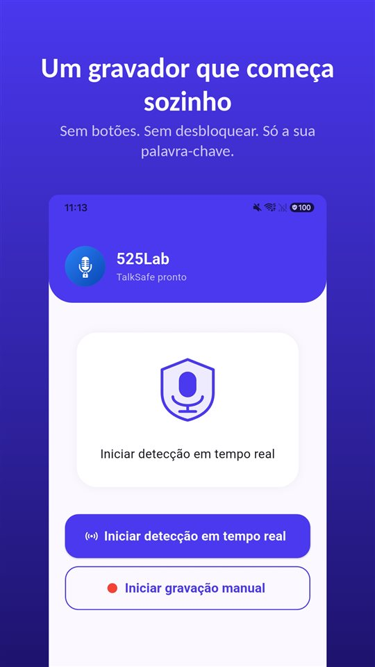

Na véspera da prova, você abre o caderno e justo aquela parte está em branco. Só lembra que o professor disse: "Isso vocês precisam saber."

Escapou enquanto você escrevia. Até terminar uma frase, a próxima já passou; enquanto você olha o quadro, a explicação acaba. Não é falta de atenção. Ouvir e escrever ao mesmo tempo é difícil por natureza.

O que você mais quer ouvir de novo costuma ser exatamente o que escapou enquanto você anotava.

## Gravar uma aula: o que usar em cada caso

| Situação | Como | No TalkSafe |
|---|---|---|
| Você quer a aula inteira | Começar a gravar no início e parar no fim | Iniciar gravação manual na tela inicial |
| Você só quer o que importa | Deixar as palavras do professor iniciarem a gravação | Detecção de palavras-chave; os 30 segundos que já passaram são salvos |
| Depois da aula | Ver primeiro o que foi dado | Um resumo por IA com um toque, no idioma da aula |
| Na hora de estudar | Ficar só com a explicação que precisa | Corte (o original fica) |
| A aula inteira em texto | Nenhum app transcreve 100% palavra por palavra | Sem transcrição, só resumo |

## Para a aula inteira, a gravação manual é o básico

Para gravar uma aula do começo ao fim, o mais seguro é começar a gravar quando ela começa e parar quando termina. Deixe o celular mais à frente, perto do professor, e mantenha a borda de baixo, onde fica o microfone, livre de livros e estojos. Numa sala grande, quem fala está longe; quanto mais perto você senta, mais fácil fica ouvir de novo.

O [TalkSafe](/talksafe/pt-br/) é um app de gravação de voz para Android e iPhone que começa a gravar quando detecta uma palavra escolhida antes, mas a tela inicial também tem um **botão para iniciar uma gravação manual**. Para a aula inteira, esse botão basta.

<figure class="shot"><figcaption>Tela inicial do TalkSafe. A aula inteira com a gravação manual; só o que importa com a detecção em tempo real.</figcaption></figure>

## Quando você só quer o que importa

Mesmo gravando os noventa minutos de cada aula, não vão ser muitos os dias em que você vai ouvir tudo desde o começo. O que você quer ouvir de novo costuma ser alguns minutos: quando o professor disse "isso cai na prova" ou "isso é importante".

Como **no TalkSafe as palavras-chave não estão ligadas a uma pessoa**, você pode cadastrar **o que o professor provavelmente vai dizer**, e não só as suas palavras. Com a detecção em tempo real ligada, a gravação começa no momento em que essa frase é detectada, sem desbloquear o celular, e **os 30 segundos que já tinham passado** também são salvos. Se essa frase vem no fim de uma explicação, a explicação de antes também fica.

**Duas palavras que costumam aparecer na mesma frase** deixam a detecção muito mais confiável. Pense em "isso é importante, vai cair na prova" e cadastre "importante" e "prova". Depois da detecção, a gravação dura 10 minutos, 30 minutos, 1 hora ou até você parar.

Na semana que vem, no momento em que o professor disser "essa parte é importante", o celular na mesa começa a gravar do jeito que está. O arquivo que você vai ouvir na véspera da prova são esses minutos, não noventa.

## Depois da aula, leia primeiro o resumo

O TalkSafe cria **um resumo por IA** de uma gravação quando você pede com um toque e o mostra como uma lista de tópicos abaixo do player, na tela de detalhes. Uma aula em português é resumida em português. Um jeito de revisar é ver primeiro no resumo como foi a aula e ouvir só as partes que você não entendeu.

- **Os resumos são feitos em um servidor.** A detecção de palavras-chave funciona no celular, mas para o resumo a gravação é enviada a um servidor.
- **Trechos cortados** também podem ser resumidos. Você pode [ficar só com a explicação que precisa, mantendo o original](/blog/pt-br/trim-recording/), e resumir só ela.

Os gravadores de fábrica dos celulares Galaxy e Pixel também oferecem resumos nos modelos compatíveis. As diferenças entre os apps estão em [Como resumir um áudio gravado com IA no Android](/blog/pt-br/summarize-recording/).

## Por que não tem transcrição

Muita gente procura um recurso que escreva a aula inteira. Mas nenhum app de gravação transcreve a fala 100% palavra por palavra. A própria ajuda da Samsung diz que, para uma transcrição precisa, quem fala precisa falar com clareza e perto do microfone. Na sala de aula, o professor geralmente está longe.

Por isso o TalkSafe oferece por enquanto **só o resumo**, e pretende avaliar a transcrição quando puder ter certeza de que ela é 100% precisa. Quando as palavras exatas importam, o mais seguro é achar o momento no resumo e ouvir esse trecho da gravação.

## Gravar aula é crime? Brasil e Portugal

**No Brasil**, a lei de direitos autorais trata disso de forma direta:
- A Lei 9.610/98 protege "as conferências, alocuções, sermões e outras obras da mesma natureza" (art. 7º, II).
- O **art. 46, IV** diz que não constitui ofensa aos direitos autorais "o apanhado de lições em estabelecimentos de ensino por aqueles a quem elas se dirigem, vedada sua publicação, integral ou parcial, sem autorização prévia e expressa de quem as ministrou".
- Ou seja: o aluno pode registrar a aula para si; publicar, inteira ou em parte, exige autorização prévia e expressa do professor.

**Em Portugal** é diferente: o art. 199.º do Código Penal pune gravar palavras de outra pessoa sem consentimento, mesmo que tenham sido ditas a você. Não verificamos regras específicas para aulas; o caminho é pedir autorização ao professor.

Mais sobre gravação de conversas está em [Gravar conversa sem a outra pessoa saber é crime? No Brasil e em Portugal, a resposta é oposta](/blog/pt-br/gravar-conversa/).

## O buraco no caderno

Na próxima vez que o caderno tiver um buraco na véspera da prova, não precisa entrar em pânico. Abra o resumo, ache aquela aula e ouça de novo os minutos em que o professor disse "isso é importante".

Gravar não substitui suas anotações. Devolve o que escapou enquanto você anotava.

Informação geral, não é aconselhamento jurídico. Para um caso concreto, consulte as regras da sua escola ou um advogado. Os recursos de outros apps são descritos de acordo com a ajuda oficial no momento da escrita e podem mudar. Nós desenvolvemos o app de gravação TalkSafe.

