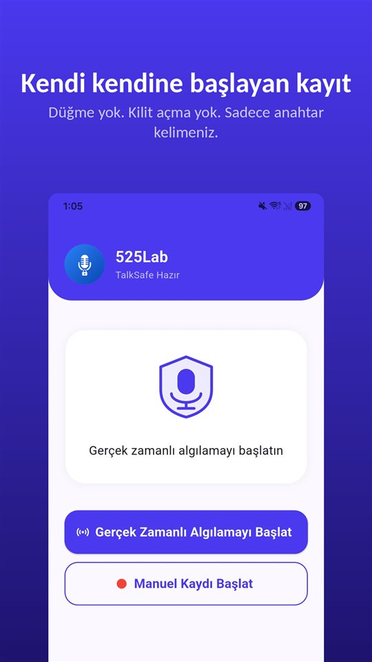

Sınavdan önceki gece notlarınızı açıyorsunuz ve tam o kısım boş. Yalnızca hocanın "Bunu mutlaka bilin" dediğini hatırlıyorsunuz.

Not alırken kaçırdınız. Bir cümleyi yazana kadar sonraki çoktan söylenmiş oluyor; tahtaya bakarken açıklama bitiyor. Bu dikkat eksikliği değil. Dinlemek ve yazmak aynı anda zaten zor.

En çok yeniden dinlemek istediğiniz söz, genellikle not alırken kaçırdığınız sözdür.

## Ders kaydı: hangi durumda ne kullanılır

| Durum | Nasıl | TalkSafe'te |
|---|---|---|
| Dersin tamamını istiyorsunuz | Başta kaydı başlatıp sonda durdurmak | Başlangıç ekranında manuel kayıt |
| Yalnızca önemli kısımları istiyorsunuz | Hocanın sözlerinin kaydı başlatması | Anahtar kelime algılama; geçmiş 30 saniye saklanır |
| Dersten sonra | Önce neler işlendiğine göz atmak | Her kaydın yapay zekâ özeti, dersin dilinde |
| Çalışırken | Yalnızca gereken açıklamayı tutmak | Kırpma (orijinal kalır) |
| Dersin tamamı yazıyla | Hiçbir uygulama yüzde 100 kelimesi kelimesine dökemez | Döküm yok, yalnızca özet |

## Dersin tamamı için temel yol manuel kayıt

Bir dersi baştan sona kaydetmek için en sağlamı, ders başlarken kaydı başlatıp biterken durdurmaktır. Telefonu öne doğru, hocaya daha yakın koyun ve mikrofonun bulunduğu alt kenarı kitap ve kalem kutusundan uzak tutun. Amfide konuşan kişi uzaktadır; ne kadar yakın oturursanız yeniden dinlemek o kadar kolay olur.

[TalkSafe](/talksafe/tr/), önceden belirlenen bir kelimeyi algıladığında kayda başlayan Android ve iPhone için bir ses kayıt uygulamasıdır, ama başlangıç ekranında **manuel kaydı başlatma düğmesi** de vardır. Dersin tamamı için bu düğme yeterlidir.

<figure class="shot"><figcaption>TalkSafe başlangıç ekranı. Dersin tamamı manuel kayıtla, yalnızca önemli kısımlar gerçek zamanlı algılamayla.</figcaption></figure>

## Yalnızca önemli olanı tutmak istediğinizde

Her dersin doksan dakikasını kaydetseniz de onları baştan dinlediğiniz gün pek olmaz. Yeniden dinlemek istediğiniz genellikle birkaç dakikadır: hocanın "Bu sınavda çıkar" ya da "Burası önemli" dediği yer.

**TalkSafe'te anahtar kelimeler bir kişiye bağlı olmadığı için**, yalnızca kendi sözlerinizi değil, **hocanın muhtemelen söyleyeceği sözleri** de kaydedebilirsiniz. Gerçek zamanlı algılama açıkken o söz algılandığı anda telefonun kilidini açmadan kayıt başlar ve **geçmiş 30 saniye** de saklanır. O söz bir açıklamanın sonunda geldiyse, önceki açıklama da kayıtta kalır.

**Aynı cümlede birlikte geçmesi muhtemel iki kelime** algılamayı çok daha güvenilir hale getirir. "Burası önemli, sınavda çıkar" cümlesini düşünün ve "önemli" ile "sınavda" kelimelerini kaydedin. Algılamadan sonra kayıt 10 dakika, 30 dakika, 1 saat ya da siz durdurana kadar sürer.

Gelecek hafta hoca "Bu kısım önemli" dediği anda, sıradaki telefon olduğu yerde kayda başlar. Sınavdan önceki gece dinleyeceğiniz dosya doksan dakika değil, o birkaç dakikadır.

## Dersten sonra önce özeti okuyun

TalkSafe **her kayıt için bir yapay zekâ özeti** oluşturur ve bunu kayıt ayrıntısı ekranında oynatıcının altında madde listesi olarak gösterir. Türkçe bir ders Türkçe özetlenir. Tekrar etmenin bir yolu, önce özette dersin akışına göz atıp yalnızca anlamadığınız kısımları dinlemektir.

- **Özetler bir sunucuda yapılır.** Anahtar kelime algılama telefonda çalışır, ancak özet için kayıt bir sunucuya gönderilir.
- **Kırpılmış bölümler** de özetlenebilir. [Yalnızca gereken açıklamayı orijinali koruyarak kırpıp](/blog/tr/trim-recording/) yalnızca onu özetleyebilirsiniz.

Galaxy ve Pixel telefonların yerleşik kayıt uygulamaları da desteklenen modellerde özet sunar. Uygulamalar arasındaki farklar [Android'de ses kaydı yapay zekâ ile nasıl özetlenir](/blog/tr/summarize-recording/) yazısında.

## Neden döküm yok

Pek çok kişi dersin tamamını yazıya döken bir özellik arıyor. Ama hiçbir kayıt uygulaması konuşmayı yüzde 100 kelimesi kelimesine yazıya dökemez. Samsung'un kendi yardım sayfası, doğru bir döküm için konuşanın net ve mikrofona yakın konuşması gerektiğini söyler. Amfide hoca çoğu zaman mikrofondan uzaktadır.

Bu yüzden TalkSafe şimdilik **yalnızca özet** sunuyor ve dökümün yüzde 100 doğru olduğundan emin olabildiğinde eklemeyi değerlendirmeyi planlıyor. Tam ifade önemli olduğunda en sağlamı, yeri özetten bulup kaydın o kısmını dinlemektir.

## Türkiye'de ders kaydı ve rıza

- **Türk Ceza Kanunu'nun 133. maddesinin 2. fıkrası**, katıldığınız aleni olmayan bir söyleşiyi diğer konuşanların rızası olmadan ses alma cihazıyla kaydetmeyi suç sayar. Bir dersin bu anlamda aleni olup olmadığına dair bir mahkeme kararı ya da resmî açıklama bulamadık.
- **Fikir ve Sanat Eserleri Kanunu'nun 38. maddesi**, eserlerin kâr amacı güdülmeden şahsen kullanmaya mahsus çoğaltılmasına izin verir; bu çoğaltma hak sahibinin meşru menfaatlerine haklı bir sebep olmadan zarar veremez.

Bu yüzden en güvenli yol, ilk derste hocanın rızasını almaktır: "Tekrar etmek için kaydedebilir miyim?" diye bir kez sormak yeterlidir. Ses kaydıyla ilgili hukukun tamamı [Gizli ses kaydı almak suç mu? Türkiye'de kendi konuşmanızı kaydetmek de suç](/blog/tr/ses-kaydi-suc-mu/) yazısında.

## Notlarınızdaki o boşluk

Bir sonraki sınavdan önceki gece notlarınızda boşluk olursa telaşa gerek yok. Özeti açın, o dersi bulun ve hocanın "Burası önemli" dediği birkaç dakikayı yeniden dinleyin.

Kayıt notlarınızın yerini tutmaz. Not alırken kaçırdığınızı size geri verir.

Genel bilgilendirme amaçlıdır, hukuki tavsiye değildir. Somut bir durum için okulunuzun kurallarını kontrol edin ya da bir avukata danışın. Diğer uygulamaların özellikleri yazıldığı tarihteki resmi yardım sayfalarına göre anlatılmıştır ve değişebilir. Ses kayıt uygulaması TalkSafe'i biz geliştiriyoruz.

