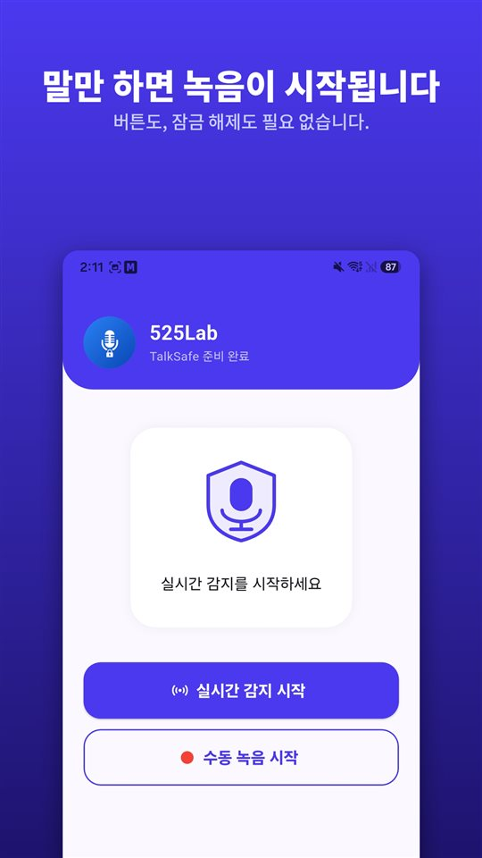

시험 전날 밤, 노트를 펴 보니 그 부분만 비어 있습니다. 교수님이 "이건 꼭 알아 두세요"라고 했던 것만 기억납니다.

필기하느라 놓친 겁니다. 받아 적는 동안 다음 말은 이미 지나가고, 칠판을 보는 동안 설명은 끝나 있습니다. 집중을 안 한 게 아니라, 듣는 것과 쓰는 것을 동시에 하는 게 원래 어렵습니다.

강의에서 다시 듣고 싶은 말은 대개 필기하느라 놓친 그 말입니다.

## 강의 녹음, 상황에 맞는 방법

| 상황 | 방법 | TalkSafe에서 |
|---|---|---|
| 수업 전체를 남기고 싶을 때 | 시작할 때 녹음을 켜고 끝날 때 멈춤 | 시작 화면의 수동 녹음 시작 |
| 중요한 대목만 남기고 싶을 때 | 교수가 할 법한 말로 녹음 시작 | 키워드 감지, 이미 지나간 30초까지 저장 |
| 수업이 끝난 뒤 | 무엇을 배웠는지 먼저 훑기 | 녹음마다 AI 요약, 강의한 언어 그대로 |
| 복습할 때 | 필요한 설명만 따로 | 잘라내기(원본은 남음) |
| 전체를 글로 | 100% 그대로 옮기는 앱은 없음 | 받아쓰기 없음, 요약만 |

## 수업 전체를 남길 때는 수동 녹음이 기본입니다

강의를 처음부터 끝까지 녹음할 때는 수업이 시작될 때 녹음을 켜고 끝날 때 멈추는 것이 가장 확실합니다. 휴대폰은 교수와 가까운 앞자리 쪽에 두고, 마이크가 있는 아래쪽 가장자리가 책이나 필통에 가려지지 않게 합니다. 강의실은 말하는 사람과 거리가 멀어서, 자리가 가까울수록 다시 들을 때 편합니다.

[TalkSafe](/talksafe/)는 미리 정해둔 말이 감지되면 녹음을 시작하는 안드로이드·아이폰 녹음 앱이지만, 시작 화면에 **수동 녹음 시작** 버튼도 있습니다. 수업 전체를 녹음할 때는 이 버튼 하나면 됩니다.

<figure class="shot"><figcaption>TalkSafe 시작 화면. 수업 전체는 수동 녹음 시작으로, 중요한 대목만 남길 때는 실시간 감지로 녹음합니다.</figcaption></figure>

## 중요한 대목만 남기고 싶을 때

매 수업 90분을 다 녹음해도, 그 파일을 처음부터 다시 듣는 날은 많지 않습니다. 다시 듣고 싶은 건 대개 몇 분입니다. 교수가 "이건 시험에 나와요", "여기 중요합니다"라고 말한 대목입니다.

TalkSafe는 **키워드가 화자에 묶여 있지 않아서**, 내가 할 말이 아니라 **교수가 할 법한 말**을 걸어 둘 수 있습니다. 실시간 감지를 켜 두면 그 말이 감지되는 순간 잠금화면을 풀 필요 없이 바로 녹음이 시작되고, **이미 지나간 30초**까지 함께 저장됩니다. 그 말이 설명 끝에 나왔다면, 앞의 설명까지 함께 남는 셈입니다.

**한 문장에 함께 나올 법한 두 단어**를 등록하면 감지가 훨씬 정확해집니다. "여기 중요하니까 시험에 나옵니다"를 떠올려 '중요'와 '시험'을 함께 등록하는 식입니다. 감지 후 녹음 시간은 10분, 30분, 1시간, 수동 종료 중에서 고를 수 있습니다.

다음 주 수업에서 교수가 "이 부분 중요합니다"라고 말하는 순간, 책상 위 휴대폰은 그대로 녹음을 시작합니다. 시험 전날 다시 들을 파일은 90분짜리가 아니라 그 몇 분입니다.

## 끝난 뒤에는 요약부터 봅니다

TalkSafe는 **녹음마다 AI 요약**을 만들어 녹음 상세 화면의 재생기 아래에 글머리 목록으로 보여 줍니다. 한국어 강의는 한국어로 요약됩니다. 요약으로 그날 수업의 흐름을 먼저 훑고, 이해가 안 되는 대목만 찾아서 듣는 방법이 있습니다.

- **요약은 서버에서 만들어집니다.** 키워드 감지는 휴대폰 안에서 이루어지지만, 요약을 위해서는 녹음을 서버로 보냅니다.
- **잘라낸 파일에도** 요약을 쓸 수 있습니다. 필요한 설명만 [원본을 남기고 잘라 낸](/blog/ko/trim-recording/) 뒤 그 부분만 요약할 수도 있습니다.

갤럭시와 픽셀의 기본 녹음 앱에도 지원 기종에서 요약 기능이 있습니다. 앱마다 다른 점은 [녹음 요약 AI, 안드로이드에서 쓰는 방법](/blog/ko/summarize-recording/)에 정리했습니다.

## 받아쓰기를 넣지 않은 이유

강의를 글자로 전부 받아 적어 주는 기능을 찾는 분이 많습니다. 다만 말을 100% 그대로 옮기는 받아쓰기는 어떤 녹음 앱도 하지 못합니다. 삼성도 정확한 받아쓰기를 위해서는 말하는 사람이 또렷하게, 마이크 가까이에서 말해야 한다고 안내합니다. 강의실은 교수가 마이크에서 먼 경우가 대부분입니다.

그래서 TalkSafe는 지금 받아쓰기 없이 **요약만** 제공합니다. 받아쓰기가 100% 정확하다고 확신할 수 있을 때 추가를 검토할 계획입니다. 정확한 표현이 필요할 때는 요약으로 위치를 찾고 그 부분의 녹음을 직접 듣는 것이 가장 확실합니다.

## 수업 녹음은 불법일까

공부용으로 수업을 녹음하는 것 자체를 처벌하는 규정은 찾지 못했습니다. 수업 녹음에서 법이 다루는 쪽은 저작권입니다.

- **강의는 저작물입니다.** 저작권법 제4조 제1항 제1호는 어문저작물의 예로 '강연'을 듭니다.
- **개인 공부용은 허용되는 범위입니다.** 제30조는 공표된 저작물을 영리 목적 없이 개인적으로 이용하는 경우 복제할 수 있다고 정합니다. 다만 이 조항이 강의 녹음에 그대로 적용되는지 판단한 판결이나 정부 안내는 찾지 못했습니다.
- **퍼뜨리는 것은 다릅니다.** 녹음한 강의를 단톡방이나 인터넷에 올리는 것은 개인적인 이용을 넘습니다.
- **학교 규칙과 교수의 뜻이 먼저입니다.** 녹음을 금지하는 수업이라면 그 규칙을 따릅니다.

가장 간단한 방법은 첫 수업이 끝난 뒤 "복습하려고 녹음해도 될까요?"라고 한 번 묻는 것입니다. 대화 녹음에 관한 법 전체는 [한국에서 대화 녹음은 합법인가](/blog/ko/korea-recording-law/)에 정리했습니다.

## 시험 전날, 비어 있던 그 부분

다음 시험 전날 노트에 빈칸이 있어도, 이번에는 당황하지 않아도 됩니다. 요약을 열어 그 수업을 찾고, 교수가 "중요하다"고 했던 몇 분을 다시 들으면 됩니다.

녹음은 필기를 대신하는 게 아니라, 필기하느라 놓친 말을 돌려받는 방법입니다.

이 글은 일반적인 정보 제공을 위한 것이며 법률 자문이 아닙니다. 구체적인 사안은 변호사와 상담하시기 바랍니다. 다른 앱의 기능은 작성 시점의 공식 안내를 기준으로 했으며 바뀔 수 있습니다. 저희는 녹음 앱 TalkSafe를 만들고 있습니다.

