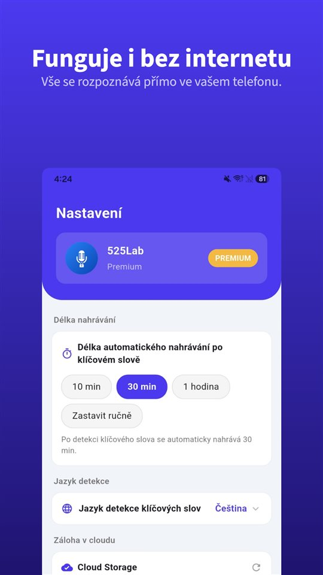

Nový telefon je vybalený a starý půjde na protiúčet. Fotky a kontakty se prý přenesou samy. U hovoru a rozhovoru, které jste před pár měsíci nahráli, si tak jistí nejste.

Platí to hlavně při přechodu z Androidu na iPhone nebo naopak. Mezi telefony stejné značky se o všechno postará nástroj na přenos; když se změní systém, změní se i aplikace na nahrávání. Je normální nevědět, kam nahrávky zmizí.

Jestli vás nahrávky do nového telefonu následují, se rozhodne dřív, než odevzdáte ten starý.

## Přenos nahrávek podle výměny

| Výměna | Co použít | Na co se podívat |
|---|---|---|
| Galaxy → Galaxy | Samsung Smart Switch | Tabulka Samsungu uvádí hlasové nahrávky |
| Pixel → Pixel | Zálohování a synchronizace v Diktafonu | Stejný účet Google |
| Android → iPhone | Přesun do iOS od Applu | Uvádí hlasové poznámky, soubory a složky, zvukové soubory, ale ne z jaké aplikace |
| iPhone → Galaxy | Samsung Smart Switch | Přes kabel se přenesou i hlasové poznámky |
| Jakýmkoli směrem | Nabídka sdílení do cloudu, na e-mail nebo do počítače | Nejjistější způsob |
| Nahrávky z TalkSafe | Přihlášení stejným účtem Google | Zálohované nahrávky se obnoví i mezi Androidem a iPhonem |

Následující vychází z oficiální nápovědy Applu, Samsungu a Googlu v době psaní a může se změnit.

## Než odevzdáte starý telefon

Při změně systému je nejjistější **nejdřív poslat soubory nahrávek ze starého telefonu ven**. Ať jste nahrávali jakoukoli aplikací, pošlete soubory přes nabídku sdílení do cloudu, na svůj e-mail nebo do počítače a v novém telefonu si je znovu stáhnete.

- **Začněte nahrávkami, které budete potřebovat**: ke sporu, ke smlouvě nebo k návštěvě lékaře.
- **Posílejte originály beze změn.** Proč neměnit název ani datum souboru, popisujeme v [Co s nahrávkou dělat, a co s ní nedělat](/blog/cs/after-recording/).
- **Starý telefon resetujte až poté**, co soubory otevřete v novém.

## Co přenesou nástroje pro přenos dat

**Mezi telefony stejné značky** se o to postará nástroj pro přenos.
- **Galaxy → Galaxy:** tabulka Samsung Smart Switch uvádí, že mezi zařízeními Galaxy lze přenést „hlasové nahrávky, soubory poznámek“.
- **Pixel → Pixel:** se zapnutým zálohováním a synchronizací ukládá Diktafon Google nahrávky do účtu Google (recorder.google.com) a podle nápovědy Googlu po přihlášení k účtu získáte nahrávky z jakéhokoli zařízení.

**Při změně systému:**
- **Android → iPhone:** nápověda Applu k aplikaci Přesun do iOS uvádí mezi přenášeným obsahem hlasové poznámky a soubory a složky a mezi obsahem k výběru zvukové soubory. Neuvádí, kterých souborů z jaké aplikace pro nahrávání na Androidu se to týká.
- **iPhone → Galaxy:** Samsung uvádí, že hlasové poznámky se přenesou, když přenášíte přes Smart Switch kabelem.
- **iPhone → jiný Android:** i tabulka přenosu od Googlu má řádek „hlasové poznámky“ a to, zda se přenesou, závisí na způsobu (bezdrátová aplikace, kabel apod.).

Žádná z těchto nápověd neříká, zda se **nahrávky uložené v aplikaci pro nahrávání** přenesou těmito nástroji. Proto je jisté nejdřív soubory poslat ven nebo použít zálohu samotné aplikace.

**Chcete-li soubory přenést do počítače**, připojte telefon s Androidem kabelem USB, klepněte v telefonu na oznámení USB a zvolte Přenos souborů; v počítači se otevře okno se soubory. Podle Googlu některé kroky fungují až od Androidu 14.

## Nahrávky z TalkSafe se vrátí se stejným účtem Google

[TalkSafe](/talksafe/cs/) je aplikace pro nahrávání na Android a iPhone, která začne nahrávat, když rozpozná předem zvolené slovo, a má **zálohu do cloudu**. Nahrávky zálohované do cloudu lze obnovit v novém telefonu **i mezi Androidem a iPhonem, když se do aplikace přihlásíte stejným účtem Google**. Funguje to stejně z Androidu na iPhone jako z iPhonu na Android.

<figure class="shot"><figcaption>Nastavení. Vedle doby nahrávání po rozpoznání a jazyka rozpoznávání je i položka zálohování do cloudu.</figcaption></figure>

**Záloha neprobíhá automaticky, spouštíte ji sami.** Do nového telefonu se tedy dostane to, co jste zálohovali ve starém. Jakmile se rozhodnete telefon vyměnit, můžete potřebné nahrávky zálohovat do cloudu ještě před odevzdáním starého. V novém telefonu nainstalujte TalkSafe a přihlaste se stejným účtem Google.

Stejná záloha pomůže i při ztrátě telefonu nebo omylem smazané nahrávce; to popisujeme v [Jak obnovit smazanou nahrávku na Androidu: kde hledat nejdřív](/blog/cs/recover-deleted-recording/).

## Den, kdy zapnete nový telefon

Až budete příště měnit telefon, udělejte před otevřením krabice jedinou věc: pošlete nahrávky, které si chcete nechat, z telefonu ven. V den, kdy zapnete nový, tam pak budou stejně jako fotky.

Jiné aplikace a nástroje pro přenos jsou popsány podle jejich oficiální nápovědy v době psaní a mohou se změnit. Vyvíjíme aplikaci pro nahrávání TalkSafe.

