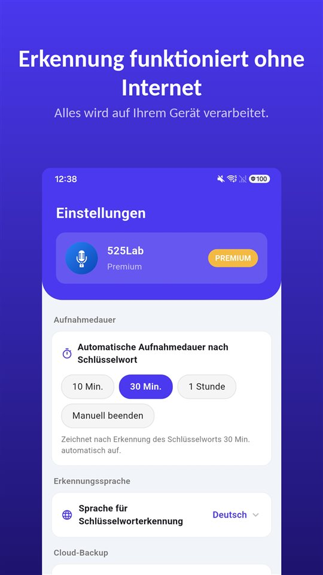

Das neue Handy ist ausgepackt, das alte geht in die Inzahlungnahme. Fotos und Kontakte kommen mit, heißt es. Bei dem Anruf und dem Gespräch, die Sie vor Monaten aufgenommen haben, sind Sie sich nicht so sicher.

Vor allem beim Wechsel von Android zu iPhone oder umgekehrt. Zwischen Handys desselben Herstellers erledigt das Umzugstool vieles; wechselt das Betriebssystem, wechselt auch die Aufnahme-App. Da ist es normal, nicht zu wissen, wo die Aufnahmen landen.

Ob Ihre Aufnahmen auf das neue Handy mitkommen, entscheidet sich, bevor Sie das alte abgeben.

## Aufnahmen umziehen, je nach Wechsel

| Wechsel | Was nutzen | Worauf achten |
|---|---|---|
| Galaxy → Galaxy | Samsung Smart Switch | Samsungs Tabelle nennt Sprachaufnahmen |
| Pixel → Pixel | Sichern und synchronisieren im Rekorder | Gleiches Google-Konto |
| Android → iPhone | Apples „Auf iOS übertragen“ | Nennt Sprachmemos, Dateien und Ordner, Audiodateien, aber nicht, welche Aufnahme-App gemeint ist |
| iPhone → Galaxy | Samsung Smart Switch | Per Kabel kommen auch Sprachmemos mit |
| In jede Richtung | Teilen-Menü in Cloud, E-Mail oder Computer | Der sicherste Weg |
| TalkSafe-Aufnahmen | Anmeldung mit demselben Google-Konto | Gesichertes lässt sich auch zwischen Android und iPhone wiederherstellen |

Das Folgende beruht auf den offiziellen Hilfeseiten von Apple, Samsung und Google zum Zeitpunkt des Schreibens und kann sich ändern.

## Bevor Sie das alte Handy abgeben

Beim Wechsel des Betriebssystems ist es am sichersten, **die Aufnahmedateien zuerst vom alten Handy herunterzuschicken**. Egal mit welcher Aufnahme-App: Schicken Sie die Dateien über das Teilen-Menü in einen Cloud-Speicher, an Ihre E-Mail oder auf einen Computer, dann holen Sie sie auf dem neuen Handy wieder ab.

- **Fangen Sie mit den Aufnahmen an, die Sie später brauchen**: zu einem Streit, einem Vertrag oder einem Arzttermin.
- **Schicken Sie die Originale unverändert.** Warum Name und Datum der Datei bleiben sollten, steht in [Was man mit einer Aufnahme tun sollte – und was nicht](/blog/de/after-recording/).
- **Setzen Sie das alte Handy erst zurück**, wenn Sie die Dateien auf dem neuen geöffnet haben.

## Was die Umzugstools mitnehmen

**Zwischen Handys desselben Herstellers** kümmert sich das Umzugstool.
- **Galaxy → Galaxy:** Samsungs Smart-Switch-Tabelle führt „Sprachaufnahmen, Memo-Dateien“ als übertragbar zwischen Galaxy-Geräten auf.
- **Pixel → Pixel:** Ist Sichern und Synchronisieren eingeschaltet, speichert Googles Rekorder die Aufnahmen im Google-Konto (recorder.google.com), und laut Googles Hilfe bekommen Sie Ihre Aufnahmen auf jedem Gerät, wenn Sie sich mit dem Konto anmelden.

**Beim Wechsel des Betriebssystems:**
- **Android → iPhone:** Apples Hilfe zu „Auf iOS übertragen“ nennt Sprachmemos sowie Dateien und Ordner unter den übertragenen Inhalten und führt Audiodateien unter den auswählbaren Inhalten auf. Welche Dateien welcher Android-Aufnahme-App dazu zählen, steht dort nicht.
- **iPhone → Galaxy:** Samsung gibt an, dass Sprachmemos mitkommen, wenn Sie mit Smart Switch per Kabel übertragen.
- **iPhone → anderes Android:** Auch Googles Umzugstabelle hat eine Zeile „Sprachmemos“, und ob sie mitkommen, hängt von der Methode ab (drahtlose App, Kabel usw.).

Keine dieser Hilfeseiten sagt, ob **Aufnahmen, die in einer Aufnahme-App gespeichert sind**, mit diesen Tools mitkommen. Deshalb ist es sicher, die Dateien vorher herunterzuschicken oder das Backup der App selbst zu nutzen.

**Um Dateien auf einen Computer zu übertragen**, verbinden Sie das Android-Handy per USB-Kabel, tippen auf dem Handy auf die USB-Benachrichtigung und wählen Dateiübertragung; auf dem Computer öffnet sich ein Dateifenster. Laut Google funktionieren einige Schritte erst ab Android 14.

## TalkSafe-Aufnahmen kommen mit demselben Google-Konto zurück

[TalkSafe](/talksafe/de/) ist eine Aufnahme-App für Android und iPhone, die mit der Aufnahme beginnt, wenn sie ein vorher festgelegtes Wort erkennt, und sie hat ein **Cloud-Backup**. In der Cloud gesicherte Aufnahmen lassen sich auf einem neuen Handy wiederherstellen, **auch zwischen Android und iPhone, wenn Sie sich mit demselben Google-Konto in der App anmelden**. Das gilt von Android zu iPhone genauso wie von iPhone zu Android.

<figure class="shot"><figcaption>Einstellungen. Neben der Aufnahmedauer nach einer Erkennung und der Erkennungssprache gibt es den Punkt Cloud-Sicherung.</figcaption></figure>

**Das Backup läuft nicht automatisch, Sie starten es selbst.** Auf das neue Handy kommt also, was Sie auf dem alten gesichert haben. Steht der Wechsel fest, können Sie die Aufnahmen, die Sie brauchen, vor der Abgabe des alten Handys in der Cloud sichern. Auf dem neuen Handy installieren Sie TalkSafe und melden sich mit demselben Google-Konto an.

Dasselbe Backup hilft, wenn ein Handy verloren geht oder eine Aufnahme versehentlich gelöscht wird; das steht in [Gelöschte Sprachaufnahme wiederherstellen: wo man auf Android zuerst nachsieht](/blog/de/recover-deleted-recording/).

## Der Tag, an dem Sie das neue Handy einschalten

Wenn Sie das nächste Mal das Handy wechseln, erledigen Sie vor dem Auspacken nur eines: Schicken Sie die Aufnahmen, die bleiben sollen, vom Handy herunter. Dann sind sie am Tag, an dem Sie das neue einschalten, genauso da wie Ihre Fotos.

Andere Apps und Umzugstools sind nach deren offiziellen Hilfeseiten zum Zeitpunkt des Schreibens beschrieben und können sich ändern. Wir entwickeln die Aufnahme-App TalkSafe.

