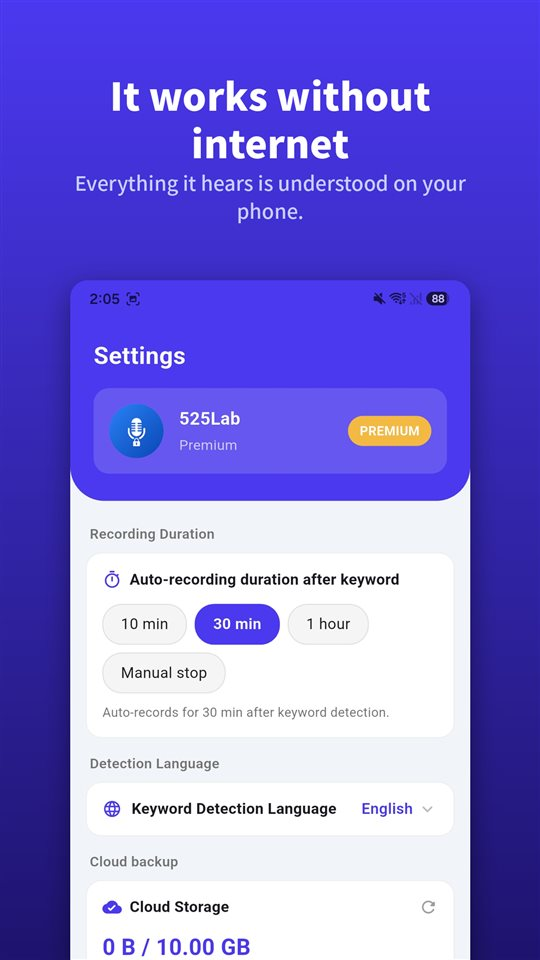

The new phone is out of the box, and the old one is going back as a trade-in. Your photos and contacts will come across, you're told. The call and the conversation you recorded months ago, you're not so sure about.

That's especially true when you switch from Android to iPhone or the other way round. Between phones from the same maker, the transfer tool takes care of things; change operating system, and the recorder app changes too. It's natural to be unsure where the recordings go.

Whether your recordings follow you to the new phone is decided before you hand in the old one.

## Moving recordings, by direction

| Switching | What to use | What to check |
|---|---|---|
| Galaxy → Galaxy | Samsung Smart Switch | Samsung's table lists voice recordings |
| Pixel → Pixel | Recorder's back up and sync | Sign in with the same Google account |
| Android → iPhone | Apple's Move to iOS | Lists Voice Memos, files and folders, audio files; doesn't say which recorder app's files |
| iPhone → Galaxy | Samsung Smart Switch | Voice Memos transfer over a cable connection |
| Any direction | Share menu to cloud, email or computer | The surest way |
| TalkSafe recordings | Sign in with the same Google account | Backed-up recordings restore between Android and iPhone |

What follows is based on Apple's, Samsung's and Google's official help at the time of writing and may change.

## Before you hand in the old phone

When you switch operating systems, the surest way is to **send the recording files off the old phone first**. Whatever recorder you used, send the files through the phone's share menu to a cloud drive, your email or a computer, and you can get them back on the new phone.

- **Start with the recordings you'll need later**: the ones about a dispute, a contract or a medical visit.
- **Send the originals as they are.** Why the file name and date should stay untouched is in [What to do with a recording, and what not to do with it](/blog/en/after-recording/).
- **Reset the old phone only after** you've opened the files on the new one.

## What the transfer tools carry across

**Between phones from the same maker**, the transfer tool takes care of it.
- **Galaxy → Galaxy:** Samsung Smart Switch's table lists "voice recordings, memo files" as transferable from Galaxy to Galaxy.
- **Pixel → Pixel:** with back up and sync on, Google's Recorder saves recordings to your Google Account at recorder.google.com, and Google's help says that if you log into your account, you can get your recordings from any device.

**When you change operating system:**
- **Android → iPhone:** Apple's Move to iOS help lists Voice Memos and files and folders among what gets transferred, and names audio files among the content you can select. It doesn't say which Android recorder app's files count.
- **iPhone → Galaxy:** Samsung says Voice Memos come across when you transfer with Smart Switch over a cable.
- **iPhone → another Android:** Google's transfer table also has a "Voice memos" row, and whether they move depends on the method (wireless app, cable and so on).

None of these help pages says whether **recordings kept inside a recorder app** move with these tools. That's why sending the files off first, or using the app's own backup, is the sure way.

**To move files to a computer**, connect the Android phone with a USB cable, tap the USB notification on the phone and choose File Transfer under "Use USB for"; a file window opens on the computer. Google notes that some of these steps only work on Android 14 and up.

## TalkSafe recordings come back with the same Google account

[TalkSafe](/talksafe/en/) is a voice recorder for Android and iPhone that starts recording when it detects a word you set in advance, and it has **cloud backup**. Recordings backed up to the cloud can be restored on a new phone **between Android and iPhone too, if you sign in to the app with the same Google account**. It works the same whether you go from Android to iPhone or from iPhone to Android.

<figure class="shot"><figcaption>Settings. Along with recording time after detection and detection language, there is a cloud backup item.</figcaption></figure>

**Backup is not automatic; you run it yourself.** So what comes across is what you backed up on the old phone. Once you've decided to switch, one option is to back up the recordings you need before you hand the old phone in. On the new phone, install TalkSafe and sign in with the same Google account.

The same backup also helps if a phone is lost or a recording is deleted by mistake; that's covered in [How to recover deleted voice recordings on Android: where to look first](/blog/en/recover-deleted-recording/).

## The day you switch on the new phone

Next time you change phones, do one thing before you open the box: send the recordings you need to keep off the phone. Then, the day you switch on the new one, your recordings are there just like your photos.

Other apps and transfer tools are described from their official help at the time of writing and may change. We make the recording app TalkSafe.

