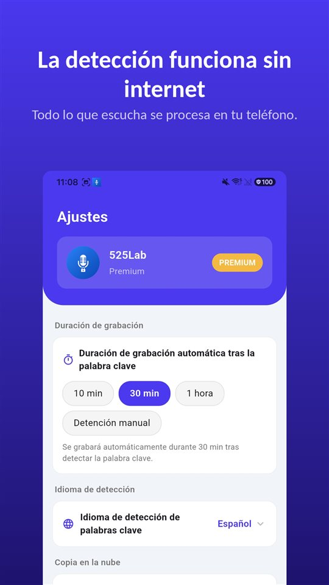

El móvil nuevo ya está fuera de la caja y el viejo va a entregarse como parte del pago. Te dicen que las fotos y los contactos pasan solos. Con la llamada y la conversación que grabaste hace meses, no lo tienes tan claro.

Pasa sobre todo al cambiar de Android a iPhone o al revés. Entre teléfonos de la misma marca, la herramienta de transferencia se ocupa de todo; si cambia el sistema operativo, cambia también la app de grabación. Es normal no saber adónde van las grabaciones.

Que tus grabaciones te sigan al teléfono nuevo se decide antes de entregar el viejo.

## Pasar grabaciones según el cambio

| Cambio | Qué usar | Qué comprobar |
|---|---|---|
| Galaxy → Galaxy | Smart Switch de Samsung | La tabla de Samsung incluye las grabaciones de voz |
| Pixel → Pixel | Copia y sincronización de la Grabadora | Misma cuenta de Google |
| Android → iPhone | Move to iOS de Apple | Incluye notas de voz, archivos y carpetas y archivos de audio, pero no dice de qué app de grabación |
| iPhone → Galaxy | Smart Switch de Samsung | Por cable, las notas de voz también pasan |
| En cualquier dirección | Menú de compartir a nube, correo u ordenador | Lo más seguro |
| Grabaciones de TalkSafe | Iniciar sesión con la misma cuenta de Google | Lo guardado se recupera también entre Android y iPhone |

Lo que sigue se basa en la ayuda oficial de Apple, Samsung y Google en el momento de escribir y puede cambiar.

## Antes de entregar el teléfono viejo

Al cambiar de sistema operativo, lo más seguro es **sacar primero los archivos de grabación del teléfono viejo**. Uses la grabadora que uses, envía los archivos con el menú de compartir del teléfono a una nube, a tu correo o a un ordenador, y podrás recuperarlos en el nuevo.

- **Empieza por las grabaciones que vas a necesitar**: las de un conflicto, un contrato o una consulta médica.
- **Envía los originales tal cual.** Por qué no conviene cambiar el nombre ni la fecha del archivo está en [Qué hacer con una grabación, y qué no hacer con ella](/blog/es/after-recording/).
- **Restablece el teléfono viejo solo después** de abrir los archivos en el nuevo.

## Lo que pasan las herramientas de transferencia

**Entre teléfonos de la misma marca**, la herramienta de transferencia se ocupa.
- **Galaxy → Galaxy:** la tabla de Smart Switch de Samsung indica que entre Galaxy se pueden transferir «grabaciones de voz, archivos de notas».
- **Pixel → Pixel:** con la copia y sincronización activada, la Grabadora de Google guarda las grabaciones en tu cuenta de Google (recorder.google.com), y según la ayuda de Google, si inicias sesión con tu cuenta puedes obtener tus grabaciones desde cualquier dispositivo.

**Al cambiar de sistema operativo:**
- **Android → iPhone:** la ayuda de Move to iOS de Apple incluye las notas de voz y los archivos y carpetas entre lo que se transfiere, y menciona los archivos de audio entre el contenido que puedes elegir. No dice qué archivos de qué app de grabación de Android cuentan.
- **iPhone → Galaxy:** Samsung indica que las notas de voz pasan si transfieres con Smart Switch por cable.
- **iPhone → otro Android:** la tabla de transferencia de Google también tiene una fila de «notas de voz», y que pasen o no depende del método (app inalámbrica, cable, etc.).

Ninguna de estas ayudas dice si **las grabaciones guardadas dentro de una app de grabación** pasan con estas herramientas. Por eso lo seguro es sacar antes los archivos o usar la copia propia de la app.

**Para pasar archivos a un ordenador**, conecta el teléfono Android con un cable USB, toca la notificación de USB en el teléfono y elige Transferencia de archivos; se abrirá una ventana de archivos en el ordenador. Según Google, algunos pasos solo funcionan en Android 14 o posterior.

## Las grabaciones de TalkSafe vuelven con la misma cuenta de Google

[TalkSafe](/talksafe/es/) es una grabadora de voz para Android y iPhone que empieza a grabar cuando detecta una palabra elegida de antemano, y tiene **copia en la nube**. Las grabaciones guardadas en la nube se pueden recuperar en un teléfono nuevo **también entre Android y iPhone, si inicias sesión en la app con la misma cuenta de Google**. Funciona igual de Android a iPhone que de iPhone a Android.

<figure class="shot"><figcaption>Ajustes. Junto al tiempo de grabación tras la detección y el idioma de detección, está la opción de copia en la nube.</figcaption></figure>

**La copia no es automática: la haces tú.** Así que lo que pasa al teléfono nuevo es lo que guardaste en la nube desde el viejo. Una vez decidido el cambio, una opción es copiar en la nube las grabaciones que necesitas antes de entregar el teléfono viejo. En el nuevo, instala TalkSafe e inicia sesión con la misma cuenta de Google.

La misma copia sirve si pierdes el teléfono o borras una grabación por error; eso está en [Cómo recuperar grabaciones de voz borradas del celular: dónde mirar primero en Android](/blog/es/recover-deleted-recording/).

## El día que enciendes el teléfono nuevo

La próxima vez que cambies de teléfono, haz una sola cosa antes de abrir la caja: saca del teléfono las grabaciones que quieres conservar. Así, el día que enciendas el nuevo, tus grabaciones estarán ahí, igual que tus fotos.

Las demás apps y herramientas de transferencia se describen según su ayuda oficial en el momento de escribir y pueden cambiar. Hacemos la app de grabación TalkSafe.

