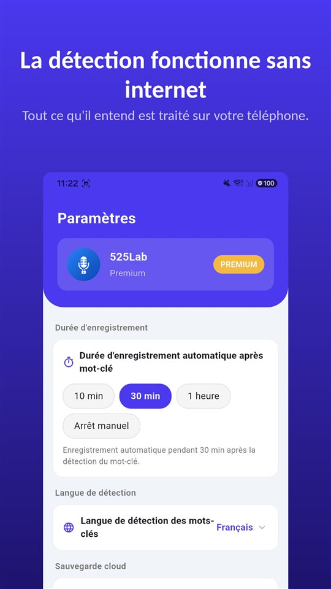

Le nouveau téléphone est sorti de sa boîte, l'ancien va partir en reprise. Les photos et les contacts suivront, vous dit-on. Pour l'appel et la conversation que vous avez enregistrés il y a quelques mois, vous n'en êtes pas si sûr.

C'est surtout vrai quand on passe d'Android à iPhone ou l'inverse. Entre téléphones d'une même marque, l'outil de transfert s'occupe de tout ; quand le système change, l'application d'enregistrement change aussi. Il est normal de ne pas savoir où partent les enregistrements.

Que vos enregistrements vous suivent sur le nouveau téléphone se décide avant de rendre l'ancien.

## Transférer ses enregistrements selon le changement

| Changement | Quoi utiliser | Quoi vérifier |
|---|---|---|
| Galaxy → Galaxy | Smart Switch de Samsung | Le tableau de Samsung cite les enregistrements vocaux |
| Pixel → Pixel | Sauvegarde et synchronisation de l'Enregistreur | Même compte Google |
| Android → iPhone | Migrer vers iOS d'Apple | Cite mémos vocaux, fichiers et dossiers, fichiers audio, sans dire de quelle application |
| iPhone → Galaxy | Smart Switch de Samsung | Par câble, les mémos vocaux passent aussi |
| Dans tous les cas | Menu de partage vers cloud, e-mail ou ordinateur | Le plus sûr |
| Enregistrements TalkSafe | Connexion avec le même compte Google | Ce qui est sauvegardé se restaure aussi entre Android et iPhone |

Ce qui suit repose sur l'aide officielle d'Apple, de Samsung et de Google au moment de la rédaction et peut changer.

## Avant de rendre l'ancien téléphone

Quand on change de système, le plus sûr est d'**envoyer d'abord les fichiers d'enregistrement hors de l'ancien téléphone**. Quelle que soit l'application utilisée, envoyez les fichiers par le menu de partage vers un stockage en ligne, votre e-mail ou un ordinateur : vous les récupérerez sur le nouveau.

- **Commencez par les enregistrements dont vous aurez besoin** : ceux d'un litige, d'un contrat ou d'une consultation.
- **Envoyez les originaux tels quels.** Pourquoi ne pas changer le nom ni la date du fichier est expliqué dans [Ce qu'il faut faire d'un enregistrement, et ce qu'il ne faut pas en faire](/blog/fr/after-recording/).
- **Ne réinitialisez l'ancien téléphone qu'après** avoir ouvert les fichiers sur le nouveau.

## Ce que transfèrent les outils de migration

**Entre téléphones d'une même marque**, l'outil de transfert s'en charge.
- **Galaxy → Galaxy :** le tableau de Smart Switch de Samsung indique qu'entre Galaxy on peut transférer les « enregistrements vocaux, fichiers de mémos ».
- **Pixel → Pixel :** avec la sauvegarde et la synchronisation activées, l'Enregistreur de Google enregistre les fichiers dans votre compte Google (recorder.google.com) et, selon l'aide de Google, en vous connectant à votre compte vous pouvez récupérer vos enregistrements depuis n'importe quel appareil.

**Quand on change de système :**
- **Android → iPhone :** l'aide de Migrer vers iOS d'Apple cite les mémos vocaux ainsi que les fichiers et dossiers parmi ce qui est transféré, et mentionne les fichiers audio parmi les contenus que l'on peut choisir. Elle ne dit pas quels fichiers de quelle application d'enregistrement Android sont concernés.
- **iPhone → Galaxy :** Samsung indique que les mémos vocaux passent si l'on transfère avec Smart Switch par câble.
- **iPhone → autre Android :** le tableau de transfert de Google comporte aussi une ligne « mémos vocaux », et leur transfert dépend de la méthode (application sans fil, câble, etc.).

Aucune de ces aides ne dit si **les enregistrements conservés dans une application d'enregistrement** passent avec ces outils. C'est pourquoi le plus sûr est de sortir d'abord les fichiers ou d'utiliser la sauvegarde de l'application elle-même.

**Pour transférer des fichiers vers un ordinateur**, branchez le téléphone Android avec un câble USB, touchez la notification USB sur le téléphone et choisissez Transfert de fichiers ; une fenêtre de fichiers s'ouvre sur l'ordinateur. Selon Google, certaines étapes ne fonctionnent qu'à partir d'Android 14.

## Les enregistrements TalkSafe reviennent avec le même compte Google

[TalkSafe](/talksafe/fr/) est une application d'enregistrement pour Android et iPhone qui démarre quand elle détecte un mot choisi à l'avance, et elle propose une **sauvegarde dans le cloud**. Les enregistrements sauvegardés dans le cloud peuvent être restaurés sur un nouveau téléphone **même entre Android et iPhone, si vous vous connectez à l'application avec le même compte Google**. C'est pareil d'Android vers iPhone et d'iPhone vers Android.

<figure class="shot"><figcaption>Réglages. À côté de la durée d'enregistrement après détection et de la langue de détection, il y a l'option de sauvegarde dans le cloud.</figcaption></figure>

**La sauvegarde n'est pas automatique : c'est vous qui la lancez.** Ce qui passe sur le nouveau téléphone, c'est donc ce que vous avez sauvegardé depuis l'ancien. Une fois le changement décidé, une possibilité est de sauvegarder dans le cloud les enregistrements utiles avant de rendre l'ancien téléphone. Sur le nouveau, installez TalkSafe et connectez-vous avec le même compte Google.

La même sauvegarde sert aussi si un téléphone est perdu ou un enregistrement supprimé par erreur ; c'est expliqué dans [Récupérer un enregistrement vocal supprimé sur Android : où chercher d'abord](/blog/fr/recover-deleted-recording/).

## Le jour où vous allumez le nouveau téléphone

La prochaine fois que vous changerez de téléphone, faites une seule chose avant d'ouvrir la boîte : sortez du téléphone les enregistrements à garder. Le jour où vous allumerez le nouveau, ils seront là, comme vos photos.

Les autres applications et outils de transfert sont décrits d'après leur aide officielle au moment de la rédaction et peuvent changer. Nous développons l'application d'enregistrement TalkSafe.

