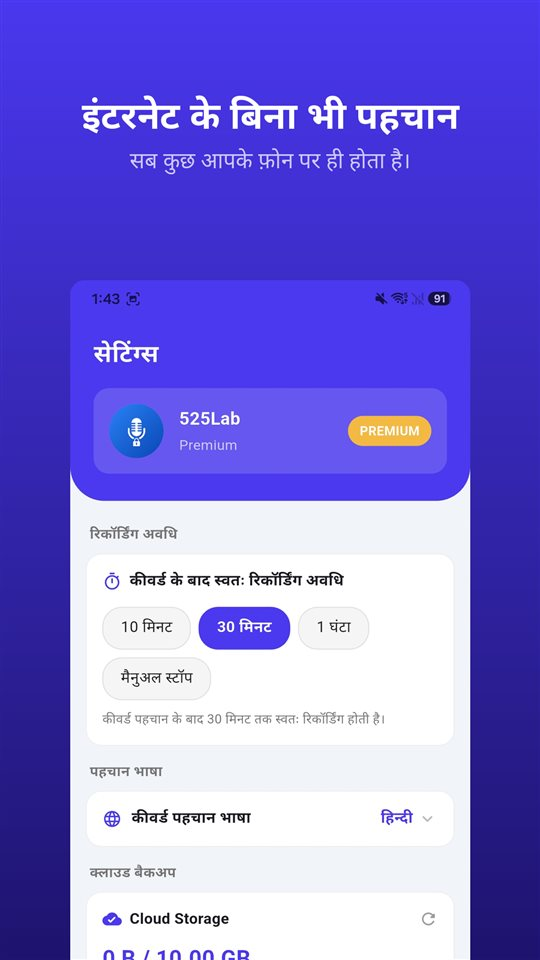

नया फ़ोन डिब्बे से निकल चुका है, और पुराना एक्सचेंज में जाने वाला है। कहा जाता है कि फ़ोटो और कॉन्टैक्ट अपने आप आ जाएँगे। लेकिन महीनों पहले रिकॉर्ड की गई वह कॉल और वह बातचीत आएगी या नहीं, इस पर आपको इतना भरोसा नहीं।

ख़ासकर तब, जब आप Android से iPhone पर या iPhone से Android पर जा रहे हों। एक ही कंपनी के फ़ोन के बीच ट्रांसफ़र टूल सब संभाल लेता है; ऑपरेटिंग सिस्टम बदलते ही रिकॉर्डिंग ऐप भी बदल जाता है। रिकॉर्डिंग कहाँ जाएँगी, यह समझ न आना स्वाभाविक है।

रिकॉर्डिंग नए फ़ोन तक पहुँचेंगी या नहीं, यह पुराना फ़ोन देने से पहले ही तय हो जाता है।

## फ़ोन बदलने की दिशा के हिसाब से रिकॉर्डिंग ले जाना

| बदलाव | क्या इस्तेमाल करें | क्या जाँचें |
|---|---|---|
| Galaxy → Galaxy | Samsung Smart Switch | Samsung की तालिका में वॉइस रिकॉर्डिंग है |
| Pixel → Pixel | Recorder का बैकअप और सिंक | वही Google खाता |
| Android → iPhone | Apple का Move to iOS | वॉइस मेमो, फ़ाइलें व फ़ोल्डर, ऑडियो फ़ाइलें बताई गई हैं, लेकिन किस रिकॉर्डर ऐप की, यह नहीं |
| iPhone → Galaxy | Samsung Smart Switch | केबल से वॉइस मेमो भी आते हैं |
| किसी भी दिशा में | शेयर मेन्यू से क्लाउड, ईमेल या कंप्यूटर | सबसे पक्का तरीका |
| TalkSafe की रिकॉर्डिंग | उसी Google खाते से लॉग इन | बैकअप की गई रिकॉर्डिंग Android और iPhone के बीच भी वापस आती हैं |

नीचे की जानकारी लिखते समय की Apple, Samsung और Google की आधिकारिक सहायता पर आधारित है और बदल सकती है।

## पुराना फ़ोन देने से पहले

ऑपरेटिंग सिस्टम बदलते समय सबसे पक्का तरीका है कि **पहले पुराने फ़ोन से रिकॉर्डिंग फ़ाइलें बाहर भेज दें**। कोई भी रिकॉर्डर ऐप इस्तेमाल किया हो, फ़ोन के शेयर मेन्यू से फ़ाइलें क्लाउड ड्राइव, अपने ईमेल या कंप्यूटर पर भेज दें, फिर नए फ़ोन पर उन्हें दोबारा ले सकते हैं।

- **पहले वे रिकॉर्डिंग चुनें जो बाद में काम आएँगी**: किसी विवाद, करार या डॉक्टर की मुलाक़ात वाली।
- **मूल फ़ाइलें जैसी हैं वैसी भेजें।** फ़ाइल का नाम और तारीख़ क्यों न बदलें, यह [रिकॉर्डिंग के बाद क्या करें, और क्या न करें](/blog/hi/after-recording/) में है।
- **पुराना फ़ोन तभी रीसेट करें** जब नए फ़ोन पर फ़ाइलें खोलकर देख लें।

## ट्रांसफ़र टूल क्या ले जाते हैं

**एक ही कंपनी के फ़ोन के बीच** ट्रांसफ़र टूल संभाल लेता है।
- **Galaxy → Galaxy:** Samsung Smart Switch की तालिका में Galaxy से Galaxy के बीच "वॉइस रिकॉर्डिंग, मेमो फ़ाइलें" ट्रांसफ़र होने योग्य बताई गई हैं।
- **Pixel → Pixel:** बैकअप और सिंक चालू हो, तो Google Recorder रिकॉर्डिंग आपके Google खाते (recorder.google.com) में सेव करता है, और Google की सहायता के अनुसार खाते से लॉग इन करने पर आप किसी भी डिवाइस से अपनी रिकॉर्डिंग पा सकते हैं।

**ऑपरेटिंग सिस्टम बदलते समय:**
- **Android → iPhone:** Apple की Move to iOS सहायता में ट्रांसफ़र होने वाली चीज़ों में वॉइस मेमो और फ़ाइलें व फ़ोल्डर गिनाए गए हैं, और चुनी जा सकने वाली सामग्री में ऑडियो फ़ाइलें भी बताई गई हैं। यह नहीं बताया गया कि Android के किस रिकॉर्डर ऐप की फ़ाइलें इसमें आती हैं।
- **iPhone → Galaxy:** Samsung के अनुसार Smart Switch से केबल के ज़रिए ट्रांसफ़र करने पर वॉइस मेमो भी आते हैं।
- **iPhone → दूसरा Android:** Google की ट्रांसफ़र तालिका में भी "वॉइस मेमो" की पंक्ति है, और वे आएँगे या नहीं, यह तरीके (वायरलेस ऐप, केबल आदि) पर निर्भर है।

इनमें से कोई भी सहायता पेज यह नहीं बताता कि **किसी रिकॉर्डर ऐप के अंदर रखी रिकॉर्डिंग** इन टूल से जाती हैं या नहीं। इसलिए पक्का तरीका है कि फ़ाइलें पहले बाहर भेज दें या ऐप का अपना बैकअप इस्तेमाल करें।

**फ़ाइलें कंप्यूटर पर ले जाने के लिए** Android फ़ोन को USB केबल से जोड़ें, फ़ोन पर आए USB नोटिफ़िकेशन पर टैप करें और File Transfer चुनें; कंप्यूटर पर फ़ाइलों की विंडो खुल जाएगी। Google के अनुसार कुछ चरण सिर्फ़ Android 14 और उसके बाद काम करते हैं।

## TalkSafe की रिकॉर्डिंग उसी Google खाते से वापस आती हैं

[TalkSafe](/talksafe/hi/) Android और iPhone के लिए एक वॉइस रिकॉर्डर ऐप है, जो पहले से चुना हुआ शब्द पहचानते ही रिकॉर्डिंग शुरू कर देता है, और इसमें **क्लाउड बैकअप** है। क्लाउड में बैकअप की गई रिकॉर्डिंग नए फ़ोन पर वापस लाई जा सकती हैं, **Android और iPhone के बीच भी, अगर आप ऐप में उसी Google खाते से लॉग इन करते हैं**। Android से iPhone जाएँ या iPhone से Android, तरीका वही है।

<figure class="shot"><figcaption>सेटिंग। पहचान के बाद रिकॉर्डिंग का समय और पहचान की भाषा के साथ क्लाउड बैकअप का विकल्प भी है।</figcaption></figure>

**बैकअप अपने आप नहीं होता, इसे आपको ख़ुद करना होता है।** इसलिए नए फ़ोन पर वही आता है जो आपने पुराने फ़ोन में बैकअप किया था। फ़ोन बदलना तय हो गया हो, तो पुराना फ़ोन देने से पहले ज़रूरी रिकॉर्डिंग क्लाउड पर बैकअप कर लेना एक तरीका है। नए फ़ोन पर TalkSafe इंस्टॉल करें और उसी Google खाते से लॉग इन करें।

यही बैकअप तब भी काम आता है जब फ़ोन खो जाए या कोई रिकॉर्डिंग गलती से डिलीट हो जाए; यह [डिलीट हुई रिकॉर्डिंग वापस कैसे लाएँ: Android पर पहले कहाँ देखें](/blog/hi/recover-deleted-recording/) में है।

## नया फ़ोन चालू करने का दिन

अगली बार फ़ोन बदलें, तो डिब्बा खोलने से पहले बस एक काम कर लें: जो रिकॉर्डिंग रखनी हैं, उन्हें फ़ोन से बाहर भेज दें। फिर नया फ़ोन चालू करने के दिन, फ़ोटो की तरह रिकॉर्डिंग भी वहीं होंगी।

दूसरे ऐप्स और ट्रांसफ़र टूल लिखते समय की उनकी आधिकारिक सहायता के आधार पर बताए गए हैं और बदल सकते हैं। हम रिकॉर्डिंग ऐप TalkSafe बनाते हैं।

