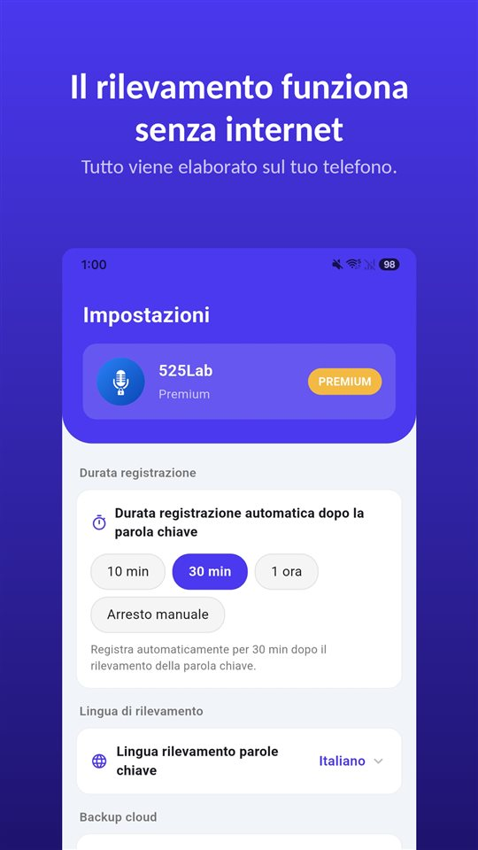

Il telefono nuovo è fuori dalla scatola e quello vecchio andrà in permuta. Ti dicono che foto e contatti passano da soli. Per la chiamata e la conversazione che hai registrato mesi fa, non ne sei così sicuro.

Succede soprattutto quando passi da Android a iPhone o viceversa. Tra telefoni della stessa marca ci pensa lo strumento di trasferimento; se cambia il sistema operativo, cambia anche l'app di registrazione. È normale non sapere dove finiscano le registrazioni.

Se le registrazioni ti seguono sul telefono nuovo si decide prima di consegnare quello vecchio.

## Spostare le registrazioni, a seconda del cambio

| Cambio | Cosa usare | Cosa controllare |
|---|---|---|
| Galaxy → Galaxy | Smart Switch di Samsung | La tabella di Samsung include le registrazioni vocali |
| Pixel → Pixel | Backup e sincronizzazione del Registratore | Stesso account Google |
| Android → iPhone | Passa a iOS di Apple | Elenca memo vocali, file e cartelle, file audio, ma non dice di quale app di registrazione |
| iPhone → Galaxy | Smart Switch di Samsung | Via cavo passano anche i memo vocali |
| In qualsiasi direzione | Menu di condivisione verso cloud, mail o computer | Il modo più sicuro |
| Registrazioni di TalkSafe | Accesso con lo stesso account Google | Ciò che hai salvato si ripristina anche tra Android e iPhone |

Quanto segue si basa sulle guide ufficiali di Apple, Samsung e Google al momento della scrittura e può cambiare.

## Prima di consegnare il telefono vecchio

Quando cambi sistema operativo, la cosa più sicura è **far uscire prima i file delle registrazioni dal telefono vecchio**. Qualunque registratore tu abbia usato, invia i file con il menu di condivisione del telefono a un cloud, alla tua mail o a un computer, e potrai riprenderli sul nuovo.

- **Parti dalle registrazioni che ti serviranno**: quelle su una lite, un contratto o una visita medica.
- **Invia gli originali così come sono.** Perché non cambiare nome e data del file è spiegato in [Cosa fare con una registrazione, e cosa non farne](/blog/it/after-recording/).
- **Ripristina il telefono vecchio solo dopo** aver aperto i file su quello nuovo.

## Cosa trasferiscono gli strumenti di passaggio

**Tra telefoni della stessa marca** ci pensa lo strumento di trasferimento.
- **Galaxy → Galaxy:** la tabella di Smart Switch di Samsung indica che tra Galaxy si possono trasferire «registrazioni vocali, file dei memo».
- **Pixel → Pixel:** con backup e sincronizzazione attivi, il Registratore di Google salva le registrazioni nel tuo account Google (recorder.google.com) e, secondo la guida di Google, accedendo all'account puoi ottenere le registrazioni da qualsiasi dispositivo.

**Quando cambi sistema operativo:**
- **Android → iPhone:** la guida di Passa a iOS di Apple elenca i memo vocali e file e cartelle tra ciò che viene trasferito, e cita i file audio tra i contenuti che puoi scegliere. Non dice quali file di quale app di registrazione Android rientrino.
- **iPhone → Galaxy:** Samsung indica che i memo vocali passano se trasferisci con Smart Switch via cavo.
- **iPhone → altro Android:** anche la tabella di trasferimento di Google ha una riga «memo vocali», e se passano dipende dal metodo (app wireless, cavo e così via).

Nessuna di queste guide dice se **le registrazioni conservate dentro un'app di registrazione** passino con questi strumenti. Per questo la via sicura è far uscire prima i file o usare il backup dell'app stessa.

**Per spostare i file su un computer**, collega il telefono Android con un cavo USB, tocca la notifica USB sul telefono e scegli Trasferimento file; sul computer si apre una finestra con i file. Secondo Google, alcuni passaggi funzionano solo da Android 14 in su.

## Le registrazioni di TalkSafe tornano con lo stesso account Google

[TalkSafe](/talksafe/it/) è un registratore vocale per Android e iPhone che inizia a registrare quando rileva una parola scelta in anticipo, e ha il **backup sul cloud**. Le registrazioni salvate sul cloud si possono recuperare su un telefono nuovo **anche tra Android e iPhone, se accedi all'app con lo stesso account Google**. Funziona allo stesso modo da Android a iPhone e da iPhone ad Android.

<figure class="shot"><figcaption>Impostazioni. Oltre alla durata della registrazione dopo il rilevamento e alla lingua di rilevamento, c'è la voce del backup nel cloud.</figcaption></figure>

**Il backup non è automatico: lo avvii tu.** Quindi passa al telefono nuovo ciò che hai salvato dal vecchio. Una volta deciso il cambio, una possibilità è salvare sul cloud le registrazioni che ti servono prima di consegnare il telefono vecchio. Sul nuovo, installa TalkSafe e accedi con lo stesso account Google.

Lo stesso backup serve se perdi il telefono o cancelli una registrazione per errore; è spiegato in [Come recuperare registrazioni vocali cancellate su Android: dove guardare prima](/blog/it/recover-deleted-recording/).

## Il giorno in cui accendi il telefono nuovo

La prossima volta che cambi telefono, fai una cosa sola prima di aprire la scatola: porta fuori dal telefono le registrazioni che vuoi tenere. Così, il giorno in cui accendi quello nuovo, le registrazioni ci sono, proprio come le foto.

Le altre app e gli strumenti di trasferimento sono descritti in base alle loro guide ufficiali al momento della scrittura e possono cambiare. Realizziamo l'app di registrazione TalkSafe.

