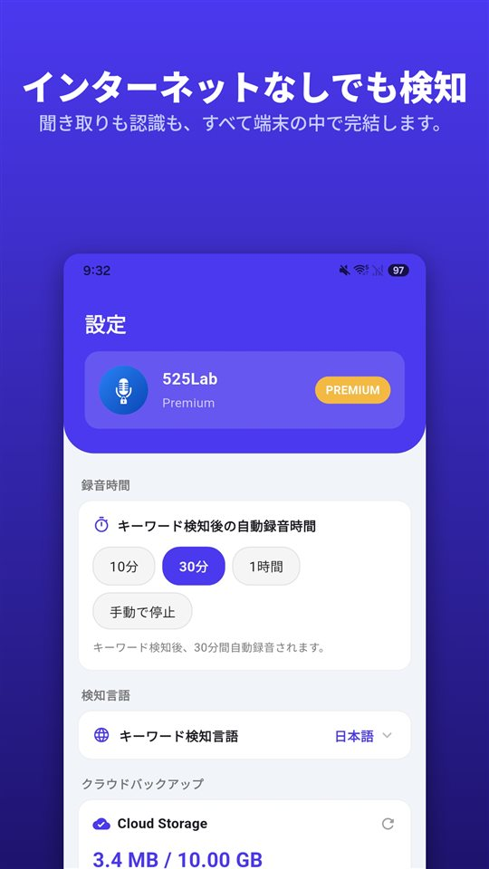

新しいスマホの箱を開けて、古いスマホは下取りに出すことにしました。写真や連絡先は移るそうですが、数か月前に録音しておいたあの通話や会話がどうなるのかは分かりません。

AndroidからiPhoneへ、iPhoneからAndroidへ乗り換えるときは特にそうです。同じメーカーのスマホ同士なら移行機能がまとめて引き継いでくれますが、OSが変わると録音アプリも変わります。録音がどこへ行くのか分からなくなるのは当然です。

録音が新しいスマホについてくるかどうかは、古いスマホを手放す前に決まります。

## 乗り換えの方向別に見る録音の移し方

| 乗り換え | 使う機能 | 確かめる点 |
|---|---|---|
| Galaxy → Galaxy | SamsungのSmart Switch | Samsungの案内表に音声録音の項目がある |
| Pixel → Pixel | レコーダーのバックアップと同期 | 同じGoogleアカウントでログイン |
| Android → iPhone | Appleの「iOSに移行」 | ボイスメモ・ファイルとフォルダ・オーディオファイルの項目はあるが、どの録音アプリのファイルかは書かれていない |
| iPhone → Galaxy | SamsungのSmart Switch | ケーブル接続ならボイスメモも移る |
| どの方向でも | 共有メニューでクラウド・メール・パソコンへ | いちばん確実 |
| TalkSafeの録音 | 同じGoogleアカウントでログイン | バックアップした録音をAndroid↔iPhoneでも復元 |

以下は執筆時点のApple・Samsung・Googleの公式案内に基づいており、変わることがあります。

## 古いスマホを手放す前にすること

OSを乗り換えるときにいちばん確実なのは、**古いスマホで録音ファイルを先に外へ送っておくこと**です。標準の録音アプリでもほかのアプリでも、スマホの共有メニューで録音ファイルをクラウドドライブや自分のメール、パソコンに送っておけば、新しいスマホでまた受け取れます。

- **あとで必要になる録音から**選びます。トラブル、契約、診察のように、もう一度取り出すことになりそうな録音です。
- **原本のまま**送ります。ファイル名や日付を変えない理由は[録音したあとにすべきことと、してはいけないこと](/blog/ja/after-recording/)にまとめています。
- **古いスマホの初期化は、新しいスマホでファイルを開いて確かめてから**にします。

## 移行機能が移してくれるもの

**同じメーカーのスマホ同士**なら、移行機能が引き継いでくれます。
- **Galaxy → Galaxy:** SamsungのSmart Switchの案内表には、Galaxy同士なら「音声録音、メモファイル」を移せると書かれています。
- **Pixel → Pixel:** Googleのレコーダーでバックアップと同期をオンにしておくと、録音はGoogleアカウント（recorder.google.com）に保存され、Googleの案内どおり同じアカウントでログインすればどの端末からでも録音を取得できます。

**OSを乗り換えるとき**はこうです。
- **Android → iPhone:** Appleの「iOSに移行」の案内は、移行される項目にボイスメモとファイルとフォルダを挙げ、移す項目を選ぶ段階でオーディオファイルを挙げています。ただし、Androidのどの録音アプリのファイルがこれにあたるかは書かれていません。
- **iPhone → Galaxy:** Samsungは、Smart Switchでケーブルをつないで移せばボイスメモも移ると案内しています。
- **iPhone → ほかのAndroid:** Googleの移行案内の表にも「ボイスメモ」の項目があり、移行の方法（ワイヤレスのアプリ、ケーブルなど）によって移るかどうかが違うと書かれています。

**録音アプリの中に保存された録音**がこうした移行機能で移るかどうかは、どの案内にも書かれていません。だからこそ、先に書いたようにファイルを外へ送っておくか、アプリ自体のバックアップを使うのが確実です。

**パソコンに移すとき**は、AndroidスマホをUSBケーブルでつなぎ、スマホに出るUSBの通知をタップして「USBの使用」でファイル転送を選ぶと、パソコンにファイルの画面が開きます。Googleの案内によると、一部の手順はAndroid 14以降でのみ動作します。

## TalkSafeの録音は同じGoogleアカウントで戻せます

[TalkSafe](/talksafe/ja/)は、あらかじめ決めておいた言葉が検知されると録音を始めるAndroid・iPhone向けの録音アプリで、**クラウドバックアップ**があります。クラウドにバックアップした録音は、**同じGoogleアカウントでアプリにログインすれば、AndroidとiPhoneの間でも**新しいスマホで復元できます。AndroidからiPhoneへでも、iPhoneからAndroidへでも同じです。

<figure class="shot"><figcaption>設定画面。検知後の録音時間、検知言語とあわせてクラウドバックアップの項目があります。</figcaption></figure>

**バックアップは自動ではなく、自分で実行します。** ですから移るのは、古いスマホでバックアップしておいた録音です。機種変更を決めたら、古いスマホを手放す前に残したい録音をクラウドにバックアップしておく方法があります。新しいスマホではTalkSafeをインストールし、同じGoogleアカウントでログインするだけです。

同じバックアップは、スマホをなくしたときや誤って削除したときにも役立ちます。その場合は[削除した録音を復元する方法：Androidでまず確認する場所](/blog/ja/recover-deleted-recording/)にまとめました。

## 新しいスマホの電源を入れる日

次にスマホを替えるときは、箱を開ける前に一つだけ済ませておけば十分です。残したい録音をスマホの外に送っておくこと。そうすれば新しいスマホの電源を入れた日、写真と同じように録音もそこにあります。

ほかのアプリや移行機能は執筆時点の公式案内に基づいており、変わることがあります。私たちは録音アプリTalkSafeを作っています。

