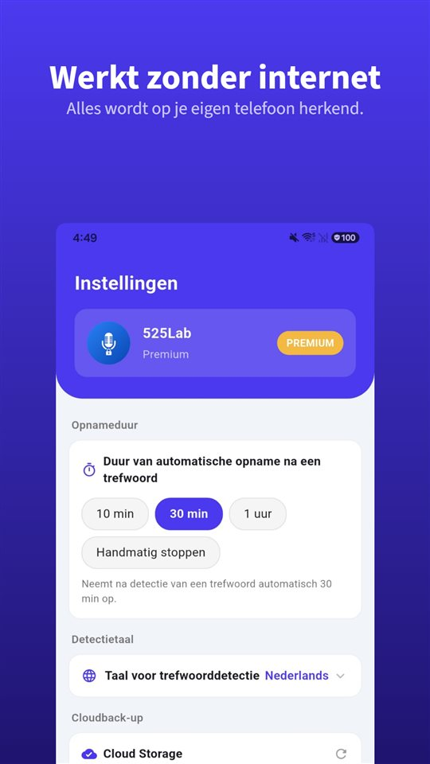

De nieuwe telefoon is uit de doos en de oude gaat in als inruil. Je foto's en contacten gaan vanzelf mee, zeggen ze. Over het telefoongesprek en het gesprek dat je maanden geleden opnam, ben je minder zeker.

Vooral als je van Android naar iPhone overstapt of andersom. Tussen telefoons van hetzelfde merk regelt de overzettool veel; verandert het besturingssysteem, dan verandert ook de opname-app. Logisch dat je niet weet waar je opnames blijven.

Of je opnames meegaan naar je nieuwe telefoon, wordt beslist voordat je de oude inlevert.

## Opnames overzetten, per overstap

| Overstap | Wat gebruik je | Waar let je op |
|---|---|---|
| Galaxy → Galaxy | Samsung Smart Switch | De tabel van Samsung noemt spraakopnames |
| Pixel → Pixel | Back-up en synchronisatie in Recorder | Hetzelfde Google-account |
| Android → iPhone | Apples Zet over naar iOS | Noemt dictafoonopnames, bestanden en mappen, audiobestanden, maar niet van welke opname-app |
| iPhone → Galaxy | Samsung Smart Switch | Via een kabel gaan spraakmemo's ook mee |
| Elke richting | Deelmenu naar cloud, e-mail of computer | De zekerste manier |
| TalkSafe-opnames | Inloggen met hetzelfde Google-account | Geback-upte opnames gaan ook tussen Android en iPhone terug |

Wat volgt is gebaseerd op de officiële hulp van Apple, Samsung en Google op het moment van schrijven en kan veranderen.

## Voordat je de oude telefoon inlevert

Als je van besturingssysteem wisselt, is het zekerst om **de opnamebestanden eerst van de oude telefoon af te sturen**. Met welke opname-app ook: stuur de bestanden via het deelmenu naar cloudopslag, je e-mail of een computer, dan haal je ze op de nieuwe telefoon weer op.

- **Begin met de opnames die je later nodig hebt**: over een conflict, een contract of een doktersbezoek.
- **Stuur de originelen ongewijzigd.** Waarom je naam en datum van het bestand laat staan, staat in [Wat je met een opname doet, en wat je er niet mee doet](/blog/nl/after-recording/).
- **Zet de oude telefoon pas terug naar fabrieksinstellingen** als je de bestanden op de nieuwe hebt geopend.

## Wat de overzettools meenemen

**Tussen telefoons van hetzelfde merk** regelt de overzettool het.
- **Galaxy → Galaxy:** de tabel van Samsung Smart Switch noemt "spraakopnames, memobestanden" als over te zetten tussen Galaxy-toestellen.
- **Pixel → Pixel:** met back-up en synchronisatie aan slaat Googles Recorder de opnames op in je Google-account (recorder.google.com), en volgens de hulp van Google kun je je opnames op elk apparaat ophalen als je inlogt met je account.

**Als je van besturingssysteem wisselt:**
- **Android → iPhone:** de hulp van Apple bij Zet over naar iOS noemt dictafoonopnames en bestanden en mappen onder wat wordt overgezet, en audiobestanden onder de inhoud die je kunt kiezen. Welke bestanden van welke Android-opname-app daaronder vallen, staat er niet.
- **iPhone → Galaxy:** Samsung geeft aan dat spraakmemo's meegaan als je met Smart Switch via een kabel overzet.
- **iPhone → andere Android:** ook de overzettabel van Google heeft een rij "spraakmemo's", en of ze meegaan hangt af van de methode (draadloze app, kabel enzovoort).

Geen van deze hulppagina's zegt of **opnames die in een opname-app zijn bewaard** met deze tools meegaan. Daarom is het zeker om de bestanden eerst weg te sturen of de back-up van de app zelf te gebruiken.

**Om bestanden op een computer te zetten**, sluit je de Android-telefoon aan met een USB-kabel, tik je op de telefoon op de USB-melding en kies je Bestandsoverdracht; op de computer opent een bestandsvenster. Volgens Google werken sommige stappen pas vanaf Android 14.

## TalkSafe-opnames komen terug met hetzelfde Google-account

[TalkSafe](/talksafe/nl/) is een opname-app voor Android en iPhone die begint met opnemen als hij een vooraf gekozen woord herkent, en heeft een **cloudback-up**. Opnames in de cloudback-up kun je op een nieuwe telefoon terugzetten, **ook tussen Android en iPhone, als je met hetzelfde Google-account in de app inlogt**. Dat werkt van Android naar iPhone net zo als van iPhone naar Android.

<figure class="shot"><figcaption>Instellingen. Naast de opnameduur na een herkenning en de herkenningstaal staat de optie cloudback-up.</figcaption></figure>

**De back-up gaat niet automatisch; je start hem zelf.** Op de nieuwe telefoon komt dus wat je op de oude hebt geback-upt. Heb je besloten over te stappen, dan kun je de opnames die je nodig hebt in de cloud zetten voordat je de oude telefoon inlevert. Op de nieuwe installeer je TalkSafe en log je in met hetzelfde Google-account.

Dezelfde back-up helpt ook als een telefoon kwijtraakt of een opname per ongeluk wordt gewist; dat staat in [Een verwijderde spraakopname terugzetten op Android: waar je eerst kijkt](/blog/nl/recover-deleted-recording/).

## De dag dat je de nieuwe telefoon aanzet

Als je de volgende keer van telefoon wisselt, doe dan vóór het openen van de doos één ding: stuur de opnames die je wilt houden van je telefoon af. Dan staan ze er de dag dat je de nieuwe aanzet, net als je foto's.

Andere apps en overzettools zijn beschreven op basis van hun officiële hulp op het moment van schrijven en kunnen veranderen. Wij maken de opname-app TalkSafe.

