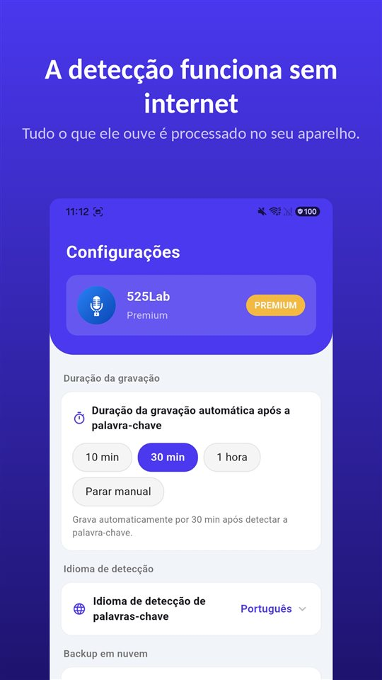

O celular novo saiu da caixa e o antigo vai na troca. Dizem que as fotos e os contatos passam sozinhos. Já aquela ligação e aquela conversa que você gravou meses atrás, você não tem tanta certeza.

Isso acontece principalmente quando você troca de Android para iPhone ou o contrário. Entre celulares da mesma marca, a ferramenta de transferência cuida de tudo; quando o sistema muda, o app de gravação também muda. É normal não saber para onde vão as gravações.

Se suas gravações vão para o celular novo é algo que se decide antes de entregar o antigo.

## Passar gravações conforme a troca

| Troca | O que usar | O que conferir |
|---|---|---|
| Galaxy → Galaxy | Smart Switch da Samsung | A tabela da Samsung inclui gravações de voz |
| Pixel → Pixel | Backup e sincronização do Gravador | Mesma conta do Google |
| Android → iPhone | Transferir para iOS da Apple | Lista gravações de voz, arquivos e pastas, arquivos de áudio, mas não diz de qual app de gravação |
| iPhone → Galaxy | Smart Switch da Samsung | Por cabo, as gravações de voz também passam |
| Em qualquer direção | Menu de compartilhar para nuvem, e-mail ou computador | O jeito mais seguro |
| Gravações do TalkSafe | Entrar com a mesma conta do Google | O que foi salvo se recupera também entre Android e iPhone |

O que vem a seguir se baseia na ajuda oficial da Apple, da Samsung e do Google no momento da escrita e pode mudar.

## Antes de entregar o celular antigo

Ao trocar de sistema, o mais seguro é **tirar primeiro os arquivos de gravação do celular antigo**. Seja qual for o gravador, mande os arquivos pelo menu de compartilhamento para uma nuvem, para o seu e-mail ou para um computador, e você os pega de volta no novo.

- **Comece pelas gravações que você vai precisar**: as de um conflito, de um contrato ou de uma consulta.
- **Mande os originais como estão.** Por que não mudar o nome nem a data do arquivo está em [O que fazer com uma gravação, e o que não fazer](/blog/pt-br/after-recording/).
- **Só restaure o celular antigo depois** de abrir os arquivos no novo.

## O que as ferramentas de transferência levam

**Entre celulares da mesma marca**, a ferramenta de transferência resolve.
- **Galaxy → Galaxy:** a tabela do Smart Switch da Samsung indica que, entre Galaxy, dá para transferir "gravações de voz, arquivos de notas".
- **Pixel → Pixel:** com o backup e a sincronização ligados, o Gravador do Google salva as gravações na sua conta do Google (recorder.google.com) e, segundo a ajuda do Google, entrando na sua conta você pega as gravações em qualquer dispositivo.

**Ao trocar de sistema:**
- **Android → iPhone:** a ajuda do Transferir para iOS da Apple inclui as gravações de voz e os arquivos e pastas entre o que é transferido, e cita os arquivos de áudio entre o conteúdo que dá para escolher. Ela não diz quais arquivos de qual app de gravação do Android entram nisso.
- **iPhone → Galaxy:** a Samsung informa que as gravações de voz passam se você transferir com o Smart Switch por cabo.
- **iPhone → outro Android:** a tabela de transferência do Google também tem uma linha de "gravações de voz", e se elas passam depende do método (app sem fio, cabo etc.).

Nenhuma dessas ajudas diz se **as gravações guardadas dentro de um app de gravação** passam com essas ferramentas. Por isso o seguro é tirar os arquivos antes ou usar o backup do próprio app.

**Para passar arquivos para um computador**, conecte o celular Android com um cabo USB, toque na notificação de USB no celular e escolha Transferência de arquivos; abre-se uma janela de arquivos no computador. Segundo o Google, alguns passos só funcionam a partir do Android 14.

## As gravações do TalkSafe voltam com a mesma conta do Google

O [TalkSafe](/talksafe/pt-br/) é um app de gravação de voz para Android e iPhone que começa a gravar quando detecta uma palavra escolhida antes, e tem **backup na nuvem**. As gravações salvas na nuvem podem ser recuperadas num celular novo **também entre Android e iPhone, se você entrar no app com a mesma conta do Google**. Vale tanto de Android para iPhone quanto de iPhone para Android.

<figure class="shot"><figcaption>Configurações. Junto do tempo de gravação depois da detecção e do idioma de detecção, há o item de backup na nuvem.</figcaption></figure>

**O backup não é automático: é você quem faz.** Então o que passa para o celular novo é o que você salvou no antigo. Decidida a troca, uma opção é salvar na nuvem as gravações que você precisa antes de entregar o celular antigo. No novo, instale o TalkSafe e entre com a mesma conta do Google.

O mesmo backup serve se o celular for perdido ou uma gravação for apagada sem querer; isso está em [Como recuperar gravação de voz apagada do celular: onde olhar primeiro no Android](/blog/pt-br/recover-deleted-recording/).

## O dia em que você liga o celular novo

Da próxima vez que trocar de celular, faça uma única coisa antes de abrir a caixa: tire do celular as gravações que você quer guardar. Assim, no dia em que ligar o novo, elas vão estar lá, como as suas fotos.

Outros apps e ferramentas de transferência são descritos de acordo com a ajuda oficial no momento da escrita e podem mudar. Nós desenvolvemos o app de gravação TalkSafe.

