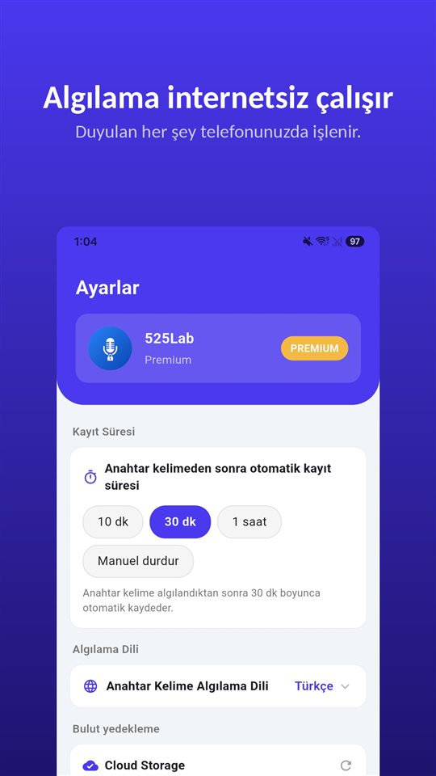

Yeni telefon kutusundan çıktı, eskisi takasa gidecek. Fotoğrafların ve rehberin taşınacağı söyleniyor. Aylar önce kaydettiğiniz o arama ve o konuşmadan ise o kadar emin değilsiniz.

Özellikle Android'den iPhone'a ya da tersine geçerken böyle olur. Aynı markanın telefonları arasında aktarma aracı işi halleder; işletim sistemi değişince kayıt uygulaması da değişir. Kayıtların nereye gittiğini bilememek çok doğal.

Kayıtlarınızın yeni telefona gelip gelmeyeceği, eskisini teslim etmeden önce belli olur.

## Geçişe göre kayıtları taşımak

| Geçiş | Ne kullanılır | Neye bakılır |
|---|---|---|
| Galaxy → Galaxy | Samsung Smart Switch | Samsung tablosunda ses kayıtları var |
| Pixel → Pixel | Kaydedici'nin yedekleme ve senkronizasyonu | Aynı Google hesabı |
| Android → iPhone | Apple'ın iOS'a Taşı uygulaması | Sesli Notlar, dosyalar ve klasörler, ses dosyaları var; hangi kayıt uygulaması olduğu yazmıyor |
| iPhone → Galaxy | Samsung Smart Switch | Kabloyla sesli notlar da geçer |
| Her yönde | Paylaşım menüsüyle buluta, e-postaya ya da bilgisayara | En sağlam yol |
| TalkSafe kayıtları | Aynı Google hesabıyla giriş | Yedeklenenler Android ile iPhone arasında da geri yüklenir |

Aşağıdakiler, yazıldığı tarihteki Apple, Samsung ve Google resmi yardım sayfalarına dayanır ve değişebilir.

## Eski telefonu teslim etmeden önce

İşletim sistemi değiştirirken en sağlamı, **kayıt dosyalarını önce eski telefondan dışarı göndermektir**. Hangi kayıt uygulamasını kullandıysanız kullanın, dosyaları telefonun paylaşım menüsüyle bir bulut depolamaya, e-postanıza ya da bir bilgisayara gönderirseniz yeni telefonda yeniden alabilirsiniz.

- **Sonra lazım olacak kayıtlardan başlayın**: bir anlaşmazlık, bir sözleşme ya da bir muayeneyle ilgili olanlar.
- **Orijinalleri olduğu gibi gönderin.** Dosya adının ve tarihinin neden değiştirilmemesi gerektiği [Bir kayıtla ne yapmalı, ne yapmamalı](/blog/tr/after-recording/) yazısında.
- **Eski telefonu ancak** dosyaları yeni telefonda açtıktan sonra sıfırlayın.

## Aktarma araçlarının taşıdıkları

**Aynı markanın telefonları arasında** aktarma aracı işi halleder.
- **Galaxy → Galaxy:** Samsung Smart Switch tablosu, Galaxy'ler arasında "ses kayıtları, not dosyaları"nın aktarılabildiğini gösterir.
- **Pixel → Pixel:** yedekleme ve senkronizasyon açıksa Google Kaydedici kayıtları Google hesabınıza (recorder.google.com) kaydeder; Google'ın yardım sayfasına göre hesabınıza giriş yaparsanız kayıtlarınızı herhangi bir cihazdan alabilirsiniz.

**İşletim sistemi değiştirirken:**
- **Android → iPhone:** Apple'ın iOS'a Taşı yardım sayfası, aktarılanlar arasında Sesli Notlar ile dosyaları ve klasörleri sayar ve seçilebilecek içerikler arasında ses dosyalarını anar. Hangi Android kayıt uygulamasının dosyalarının buna girdiğini söylemez.
- **iPhone → Galaxy:** Samsung, Smart Switch ile kabloyla aktarırsanız sesli notların da geçtiğini belirtir.
- **iPhone → başka bir Android:** Google'ın aktarım tablosunda da "sesli notlar" satırı vardır; geçip geçmediği yönteme (kablosuz uygulama, kablo vb.) göre değişir.

Bu yardım sayfalarının hiçbiri **bir kayıt uygulamasının içinde saklanan kayıtların** bu araçlarla taşınıp taşınmadığını söylemez. Bu yüzden sağlam yol, dosyaları önce dışarı göndermek ya da uygulamanın kendi yedeğini kullanmaktır.

**Dosyaları bilgisayara aktarmak için**, Android telefonu USB kabloyla bağlayın, telefondaki USB bildirimine dokunun ve Dosya aktarımı'nı seçin; bilgisayarda bir dosya penceresi açılır. Google'a göre bazı adımlar yalnızca Android 14 ve sonrasında çalışır.

## TalkSafe kayıtları aynı Google hesabıyla geri gelir

[TalkSafe](/talksafe/tr/), önceden belirlenen bir kelimeyi algıladığında kayda başlayan Android ve iPhone için bir ses kayıt uygulamasıdır ve **bulut yedekleme** özelliği vardır. Buluta yedeklenen kayıtlar, **uygulamaya aynı Google hesabıyla giriş yaparsanız Android ile iPhone arasında da** yeni telefonda geri yüklenebilir. Android'den iPhone'a da, iPhone'dan Android'e de aynıdır.

<figure class="shot"><figcaption>Ayarlar. Algılamadan sonraki kayıt süresi ve algılama dilinin yanında bulut yedekleme seçeneği de var.</figcaption></figure>

**Yedekleme otomatik değildir; kendiniz başlatırsınız.** Yani yeni telefona gelen, eski telefonda yedeklediğiniz kayıtlardır. Telefonu değiştirmeye karar verdiyseniz, eskisini teslim etmeden önce saklamanız gereken kayıtları buluta yedeklemek bir seçenek. Yeni telefonda TalkSafe'i kurup aynı Google hesabıyla giriş yapmanız yeterli.

Aynı yedek, telefon kaybolduğunda ya da bir kayıt yanlışlıkla silindiğinde de işe yarar; bu [Silinen ses kaydı geri getirme: Android'de önce nereye bakılır](/blog/tr/recover-deleted-recording/) yazısında.

## Yeni telefonu açtığınız gün

Bir dahaki telefon değişikliğinde kutuyu açmadan önce tek bir şey yapın: saklamak istediğiniz kayıtları telefonun dışına gönderin. Böylece yeni telefonu açtığınız gün kayıtlarınız da fotoğraflarınız gibi orada olur.

Diğer uygulamalar ve aktarma araçları yazıldığı tarihteki resmi yardım sayfalarına göre anlatılmıştır ve değişebilir. Ses kayıt uygulaması TalkSafe'i biz geliştiriyoruz.

