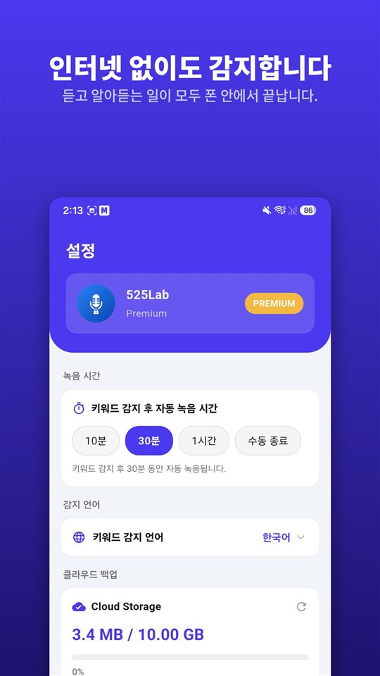

새 휴대폰 상자를 열고, 옛 휴대폰은 보상판매로 넘기기로 했습니다. 사진과 연락처는 옮겨진다는데, 몇 달 전에 녹음해 둔 그 통화와 대화는 어떻게 될지 모르겠습니다.

안드로이드에서 아이폰으로, 아이폰에서 안드로이드로 바꿀 때 특히 그렇습니다. 같은 회사 휴대폰끼리는 이전 기능이 알아서 챙겨 주지만, 운영체제가 바뀌면 녹음 앱도 바뀝니다. 녹음이 어디로 가는지 헷갈리는 건 당연합니다.

녹음이 새 휴대폰으로 따라올지는 옛 휴대폰을 넘기기 전에 정해집니다.

## 바꾸는 방향별로 보는 녹음 옮기기

| 바꾸는 방향 | 쓰는 기능 | 확인할 점 |
|---|---|---|
| 갤럭시 → 갤럭시 | 삼성 스마트 스위치 | 삼성 안내 표에 음성 녹음 항목이 있음 |
| 픽셀 → 픽셀 | 녹음 앱의 백업·동기화 | 같은 구글 계정으로 로그인 |
| 안드로이드 → 아이폰 | 애플 'iOS로 이동' | 음성 메모·파일 및 폴더·오디오 파일 항목이 있지만, 어느 녹음 앱 파일인지는 안내에 없음 |
| 아이폰 → 갤럭시 | 삼성 스마트 스위치 | 케이블로 연결하면 음성 메모도 옮겨짐 |
| 어느 방향이든 | 공유 메뉴로 클라우드·메일·컴퓨터 | 가장 확실한 방법 |
| TalkSafe 녹음 | 같은 구글 계정으로 로그인 | 백업해 둔 녹음을 안드로이드↔아이폰 사이에서도 복원 |

아래 내용은 작성 시점의 애플·삼성·구글 공식 안내를 기준으로 했으며 바뀔 수 있습니다.

## 옛 휴대폰을 넘기기 전에 할 일

운영체제를 바꿀 때 가장 확실한 방법은 **옛 휴대폰에서 녹음 파일을 먼저 밖으로 보내 두는 것**입니다. 기본 녹음 앱이든 다른 앱이든, 휴대폰의 공유 메뉴로 녹음 파일을 클라우드 드라이브나 내 메일, 컴퓨터로 보내 두면 새 휴대폰에서 다시 받을 수 있습니다.

- **나중에 필요할 녹음부터** 고릅니다. 분쟁, 계약, 진료처럼 다시 꺼낼 일이 생길 녹음입니다.
- **원본 그대로** 보냅니다. 파일 이름과 날짜를 바꾸지 않는 이유는 [녹음한 다음에 해야 할 일과 하지 말아야 할 일](/blog/ko/after-recording/)에 정리했습니다.
- **옛 휴대폰은 새 휴대폰에서 파일을 열어 본 뒤에** 초기화합니다.

## 기기 이전 기능이 옮겨 주는 것

**같은 회사 휴대폰끼리**는 이전 기능이 챙겨 줍니다.
- **갤럭시 → 갤럭시:** 삼성 스마트 스위치의 안내 표에는 갤럭시끼리 옮길 때 '음성 녹음, 메모 파일'을 옮길 수 있다고 되어 있습니다.
- **픽셀 → 픽셀:** 구글 녹음 앱의 백업·동기화를 켜 두면 녹음이 구글 계정(recorder.google.com)에 저장되고, 구글 안내대로 같은 계정으로 로그인하면 어느 기기에서든 녹음을 받을 수 있습니다.

**운영체제를 바꿀 때**는 이렇습니다.
- **안드로이드 → 아이폰:** 애플의 'iOS로 이동' 안내는 옮겨지는 항목에 음성 메모와 파일 및 폴더를 적고, 옮길 항목을 고르는 단계에 오디오 파일을 듭니다. 다만 안드로이드의 어떤 녹음 앱 파일이 여기에 해당하는지는 안내에 없습니다.
- **아이폰 → 갤럭시:** 삼성은 스마트 스위치로 케이블을 연결해 옮기면 음성 메모도 옮겨진다고 안내합니다.
- **아이폰 → 다른 안드로이드:** 구글의 이전 안내 표에도 '음성 메모' 항목이 있고, 이전 방법(무선 앱, 케이블 등)에 따라 옮겨지는지가 다르게 적혀 있습니다.

**녹음 앱 안에 보관된 녹음**이 이런 이전 기능으로 옮겨지는지는 어느 안내에도 적혀 있지 않습니다. 그래서 앞에서 말한 대로 파일을 먼저 밖으로 보내 두거나, 앱 자체의 백업을 쓰는 것이 확실합니다.

**컴퓨터로 옮길 때**는 안드로이드 휴대폰을 USB 케이블로 연결하고, 휴대폰에 뜨는 USB 알림을 눌러 'USB 사용 용도'에서 파일 전송을 고르면 컴퓨터에 파일 창이 열립니다. 구글 안내에 따르면 일부 단계는 안드로이드 14 이상에서만 동작합니다.

## TalkSafe 녹음은 같은 구글 계정으로 되살립니다

[TalkSafe](/talksafe/)는 미리 정해둔 말이 감지되면 녹음을 시작하는 안드로이드·아이폰 녹음 앱이고, **클라우드 백업**이 있습니다. 클라우드에 백업해 둔 녹음은 **같은 구글 계정으로 앱에 로그인하면 안드로이드와 아이폰 사이에서도** 새 휴대폰에서 되살릴 수 있습니다. 안드로이드에서 아이폰으로 가도, 아이폰에서 안드로이드로 가도 같습니다.

<figure class="shot"><figcaption>설정 화면. 감지 후 녹음 시간, 감지 언어와 함께 클라우드 백업 항목이 있습니다.</figcaption></figure>

**백업은 자동이 아니라 직접 실행합니다.** 그래서 옮겨지는 건 옛 휴대폰에서 백업해 둔 녹음입니다. 휴대폰을 바꾸기로 했다면, 옛 휴대폰을 넘기기 전에 남겨야 할 녹음을 클라우드에 백업해 두는 방법이 있습니다. 새 휴대폰에서는 TalkSafe를 설치하고 같은 구글 계정으로 로그인하면 됩니다.

같은 백업은 휴대폰을 잃어버렸거나 실수로 지웠을 때도 쓰입니다. 그 경우는 [삭제된 녹음 파일 복구, 안드로이드에서 먼저 확인할 곳](/blog/ko/recover-deleted-recording/)에 정리했습니다.

## 새 휴대폰을 켜는 날

다음에 휴대폰을 바꿀 때는 상자를 열기 전에 한 가지만 먼저 하면 됩니다. 남겨야 할 녹음을 휴대폰 밖으로 보내 두는 것입니다. 그러면 새 휴대폰을 켜는 날, 사진처럼 녹음도 그대로 있습니다.

다른 앱과 기기 이전 기능은 작성 시점의 공식 안내를 기준으로 했으며 바뀔 수 있습니다. 저희는 녹음 앱 TalkSafe를 만들고 있습니다.

